# Alter Ego – Desktop Assistant

🇬🇧 [English](README.md) · 🇮🇹 **Italiano**

**🌐 Sito web: [alterego.attentoweb.it](https://alterego.attentoweb.it)** · **🎬 [Trailer](#trailer)**

Assistente desktop per **Windows 10/11** ispirato ad *Alter Ego* di Danganronpa: una finestrella in stile laptop CRT,
sempre in primo piano, con cui parli a voce o per iscritto. Risponde con il proprio carattere, ricorda chi sei,
può fare clip dei tuoi giochi con una frase e, se glielo permetti, eseguire piccole azioni sul PC.

Progetto fan non ufficiale e non commerciale. Interfaccia in italiano e in inglese.

## Trailer

<a href="https://alterego.attentoweb.it/trailer.html?lang=it">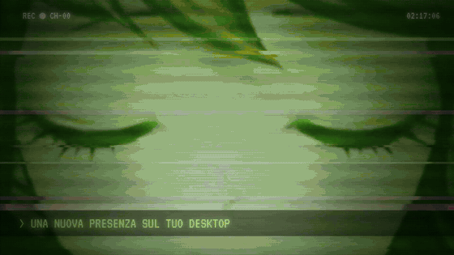</a>

**▶ [Guarda il trailer con l'audio](https://alterego.attentoweb.it/trailer.html?lang=it)** · [Versione inglese](https://alterego.attentoweb.it/trailer.html?lang=en) · [Schermo intero o nella cornice del sito](https://alterego.attentoweb.it/#trailer)

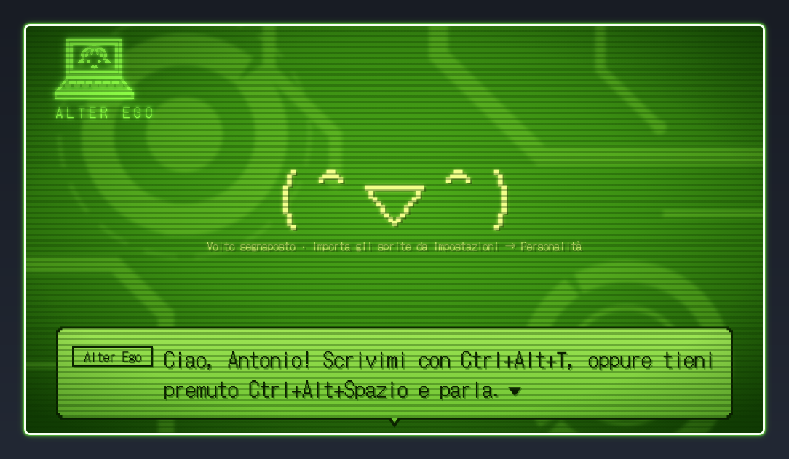

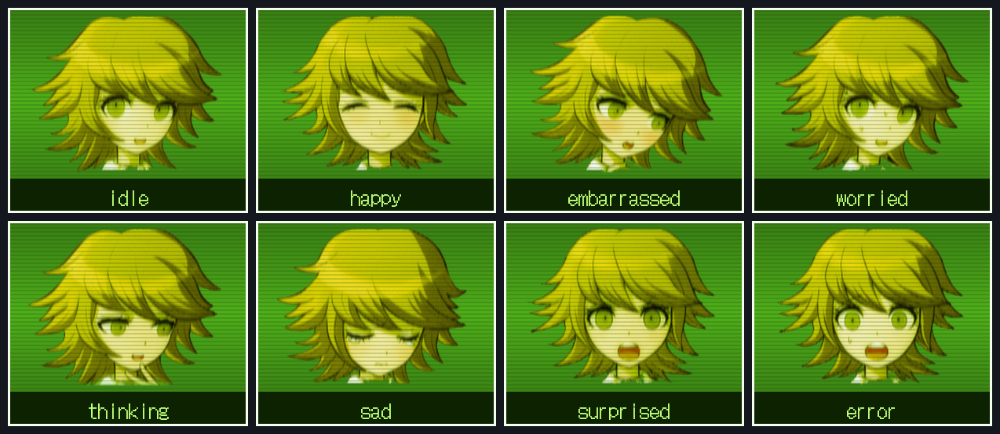

## Indice

- [Trailer](#trailer)
- [Funzionalità](#funzionalità)
- [Screenshot](#screenshot)
- [Installazione](#installazione)
- [Primo avvio](#primo-avvio)
- [Uso](#uso)
- [Intelligenza artificiale e chiavi API](#intelligenza-artificiale-e-chiavi-api)
- [Voce](#voce)
- [Mic-Link](#mic-link)
- [Musica](#musica)
- [Ricerca web](#ricerca-web)
- [Costi](#costi)
- [Clip vocali](#clip-vocali)
- [Azioni sul PC e permessi](#azioni-sul-pc-e-permessi)
- [Personalità e memoria](#personalità-e-memoria)
- [Sprite](#sprite)
- [Privacy e sicurezza](#privacy-e-sicurezza)
- [Dove stanno i dati](#dove-stanno-i-dati)
- [Risoluzione problemi](#risoluzione-problemi)
- [Sviluppo](#sviluppo)
- [Limiti noti](#limiti-noti)
- [Crediti e licenze](#crediti-e-licenze)

## Funzionalità

- **Finestra in stile Alter Ego**: schermo verde con scanline, cornice con glow, logo, box di dialogo pixel con effetto macchina da scrivere e ▼.
  Senza bordi, trasparente, sempre in primo piano, fuori dalla taskbar; si sposta, si ridimensiona (16:9) e ricorda la posizione per ogni monitor.
- **Click-through** opzionale: il mouse passa attraverso la finestra, che non ruba mai il focus mentre giochi.
- **Animazione da vecchia TV** quando la finestra si apre (una linea luminosa che si allarga) e si chiude (lo schermo collassa in una linea e poi in un punto).
- **Dialogo automatico**: se non clicchi, il testo va avanti da solo dopo qualche secondo (e aspetta che la voce finisca).
- **Interfaccia in italiano e in inglese** (automatica secondo la lingua di Windows, o a scelta); anche le risposte di Alter Ego possono seguire la lingua dell'interfaccia.
- **5 servizi AI** (Gemini, OpenRouter, Groq, DeepSeek, Ollama locale) con **fallback automatico** e **più chiavi API per servizio** a rotazione.
  Prompt e cronologia sono costruiti per sfruttare la **cache di DeepSeek** (input in cache costa molto meno).
- **Push-to-talk** con trascrizione Whisper (Groq o server locale), su tastiera o **tasti laterali del mouse**.
- **Voce** di Alter Ego: **Kokoro-82M locale** (offline, installazione con un clic), voci di Windows o servizio compatibile OpenAI; **blip** del dialogo.
- **Dispositivi audio a scelta**: altoparlanti/cuffie per la voce, microfono per il push-to-talk.
- **Mic-Link**: microfono virtuale **AlterEgo Link Audio** con la tua voce + quella di Alter Ego, da usare in Discord, OBS, giochi.
- **Musica**: "metti *titolo*" → Alter Ego cerca su YouTube e suona in un lettore in stile CRT con spettro, testo sincronizzato
  e il suo volto che cambia a tempo di musica. Mentre suona, la finestra di Alter Ego si rimpicciolisce e lei mette le cuffie.
- **Music Venue**: piccola libreria con i brani ascoltati di recente e i preferiti, ricerca e riascolto.
- **Parla con l'app**: "apri music venue", "chiudi il lettore audio", "apri il sito", "controlla gli aggiornamenti"… tutto ciò che riguarda l'app si fa chiedendolo a lei.
- **Mouse e tastiera**: se lo permetti, Alter Ego muove il cursore, clicca, scrive e preme tasti (con conferma e stop d'emergenza).
- **Riduzione del rumore** del microfono di Mic-Link (RNNoise, regolabile).
- **Aggiornamenti**: link al sito e a GitHub nell'app e un tasto per aggiornare all'ultima release.
- **Ricerca web** con le API Search e Fetch di DeepSeek, quando serve un'informazione aggiornata.
- **Pannello Costi**: ogni richiesta con token, cache, durata e costo, totali per giorno/mese e per modello, prezzi modificabili, esportazione CSV.
- **Terminale**: Alter Ego può eseguire comandi PowerShell o cmd, con conferma o in autonomia.
- **Clip vocali**: "Alter Ego clippa" → salva la clip con AMD Adrenalin, NVIDIA App o Medal, **senza passare dall'AI**.
- **Azioni sul PC** tramite tool calling, tutte spente di default, con conferma per quelle sensibili (disattivabile) e registro consultabile.
- **Memoria locale** (SQLite): ricorda le conversazioni, fa riassunti, impara fatti su di te.
- **Personalità regolabile** (timida ↔ sicura, formale ↔ affettuosa), modalità imitazione, risposte in italiano, inglese o entrambe.
- Espressioni del volto pilotate dalle risposte (felice, sorpresa, imbarazzata, triste, preoccupata, pensierosa, errore).
- Leggera: Tauri 2 (Rust) + HTML/CSS/JS vanilla, installer di circa 6 MB.

## Screenshot

| | |
|---|---|
| 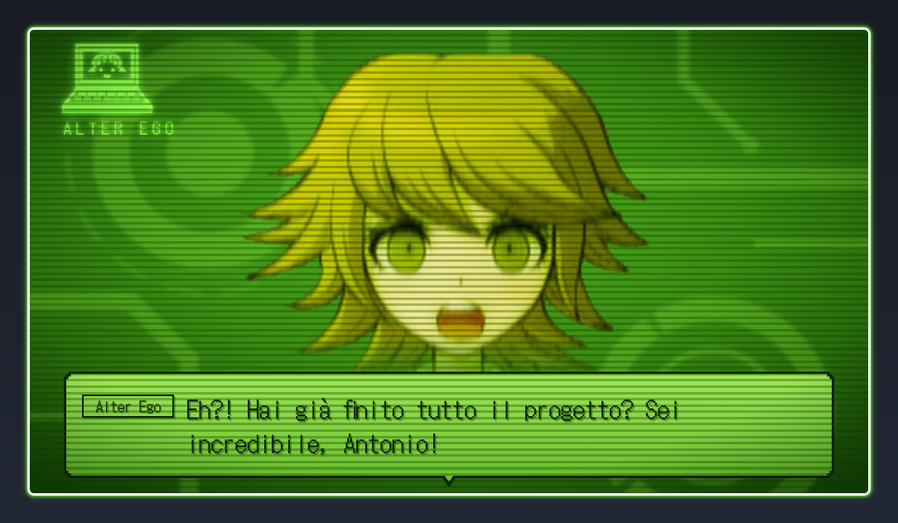 | 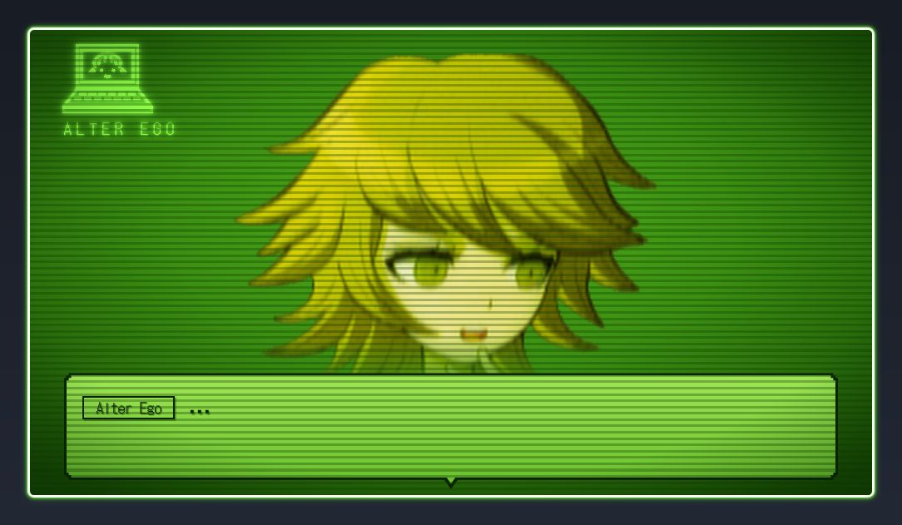 |
| Espressione dalla risposta dell'AI (`[surprised]`) | Mentre pensa, solo scanline |
| 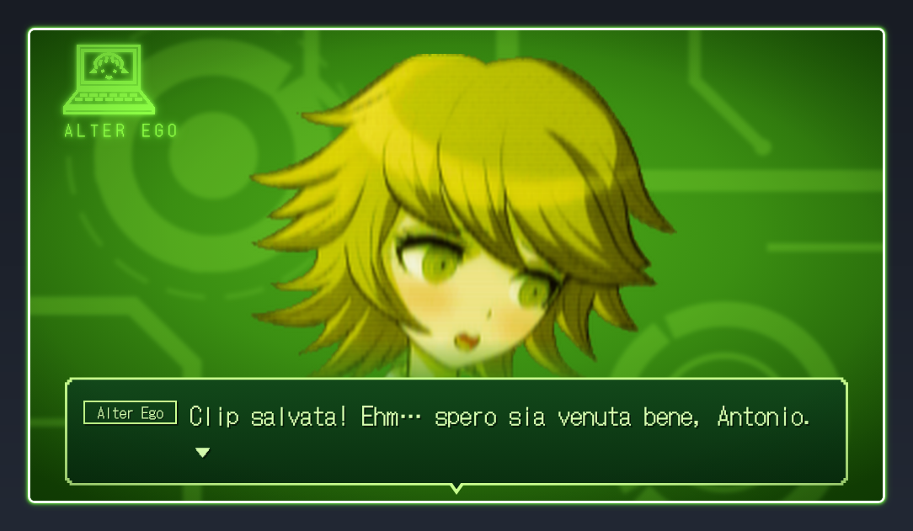 | 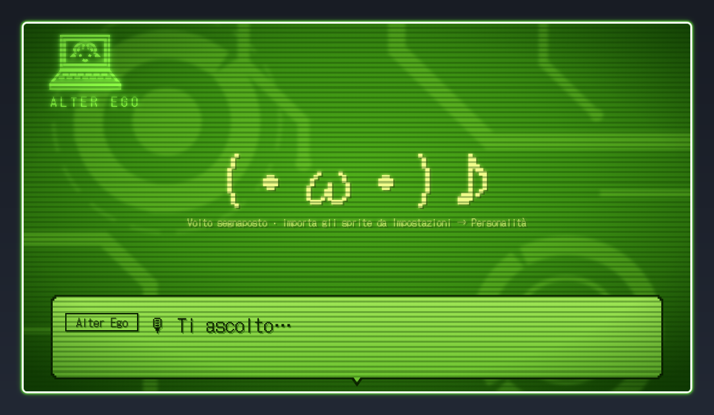 |
| Box scuro e sfondo a circuiti | Push-to-talk: in ascolto |
| 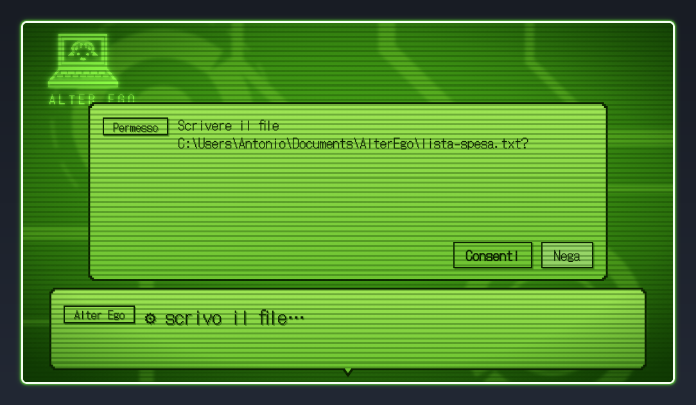 | 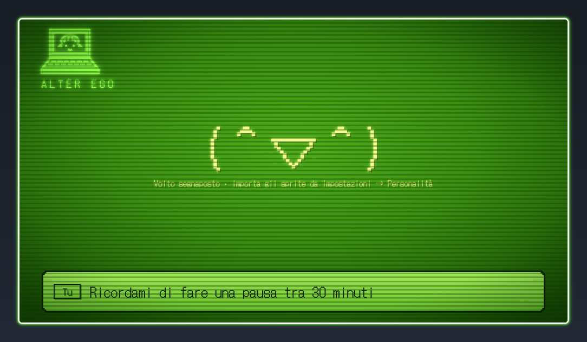 |
| Conferma prima di un'azione sul PC | Scrivere ad Alter Ego (`Ctrl+Alt+T`) |

**Lettore musicale**

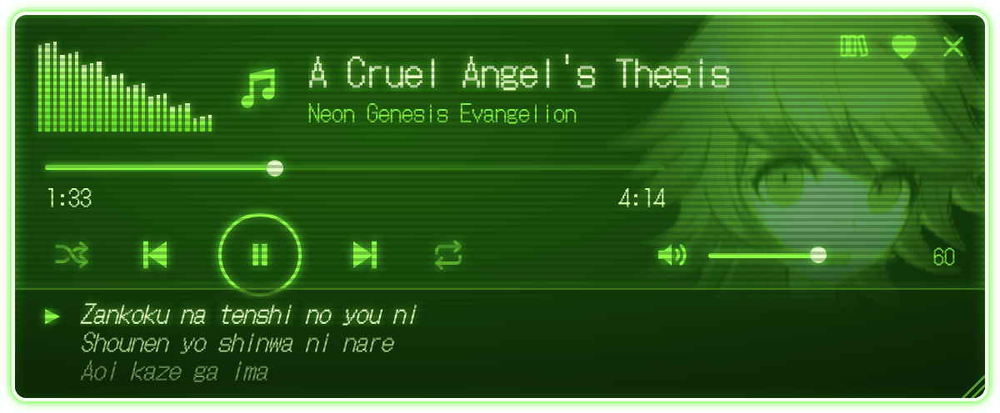

**Spegnimento e accensione "vecchia TV"**

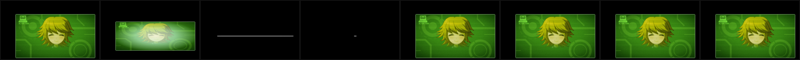

**Impostazioni**

| | |
|---|---|
| 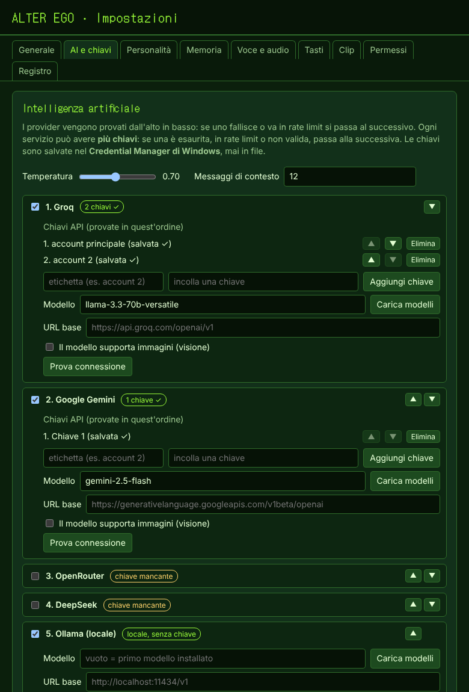 | 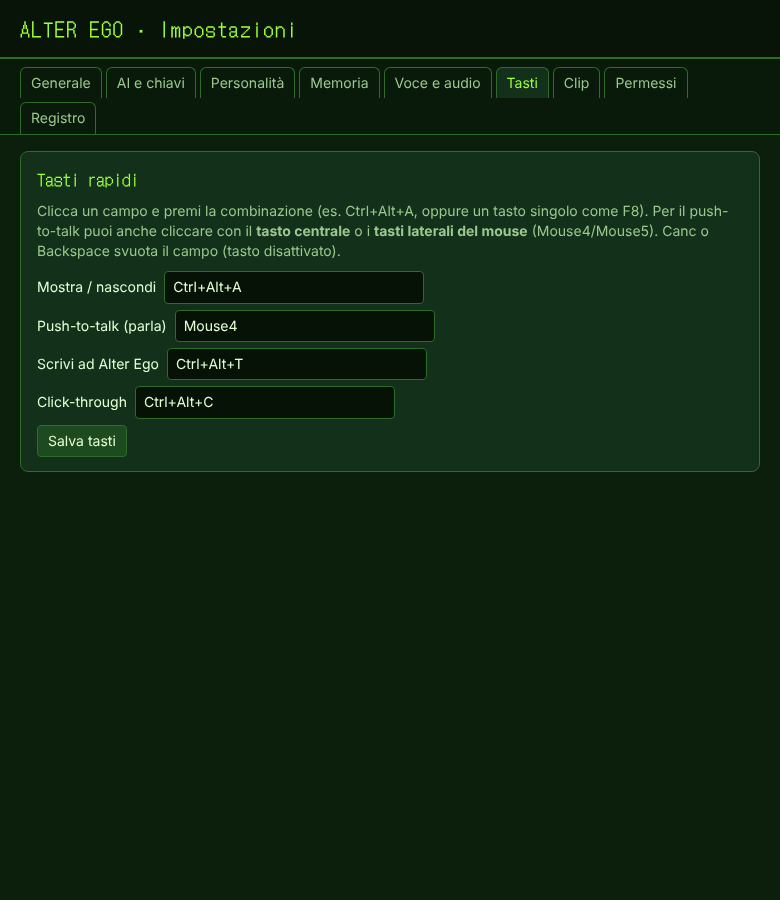 |
| Servizi AI, più chiavi, ordine di fallback | Tasti rapidi (anche mouse) |
| 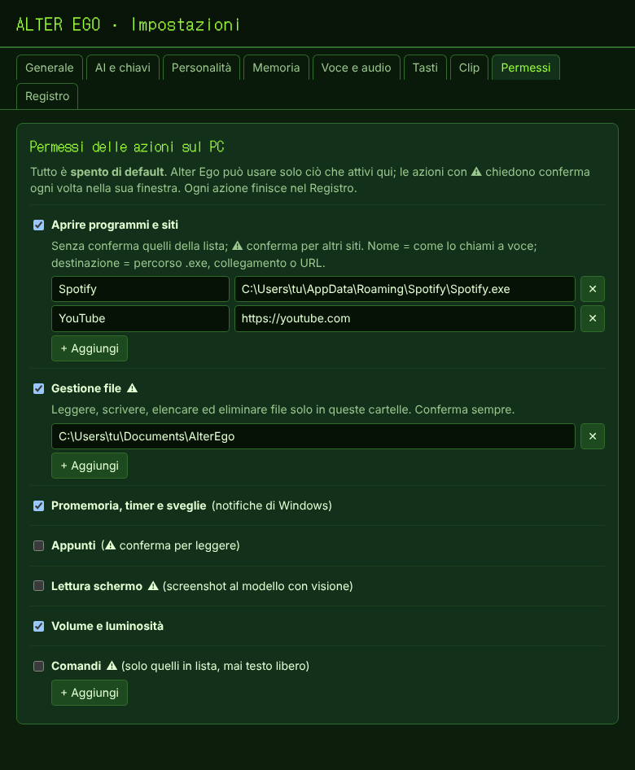 | 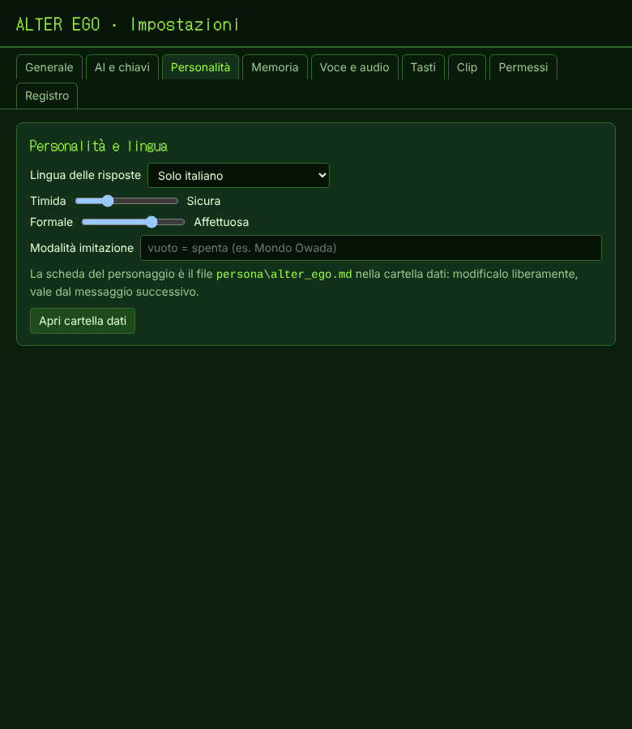 |
| Permessi delle azioni | Personalità e lingua |
| 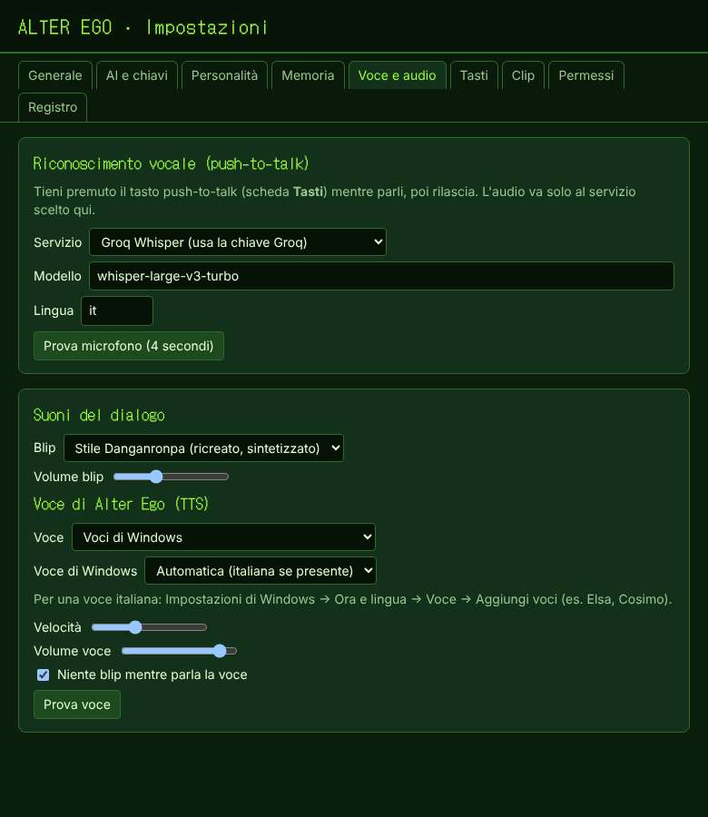 | 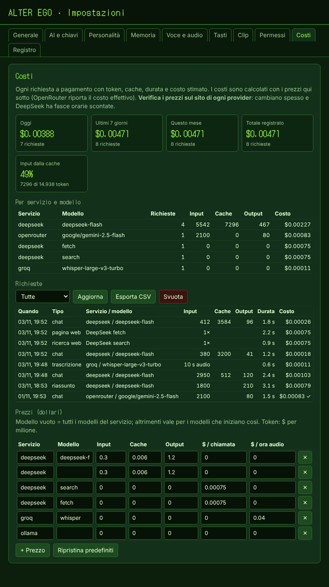 |
| Dispositivi, Kokoro, musica, Mic-Link | Costi di ogni richiesta e prezzi |
| 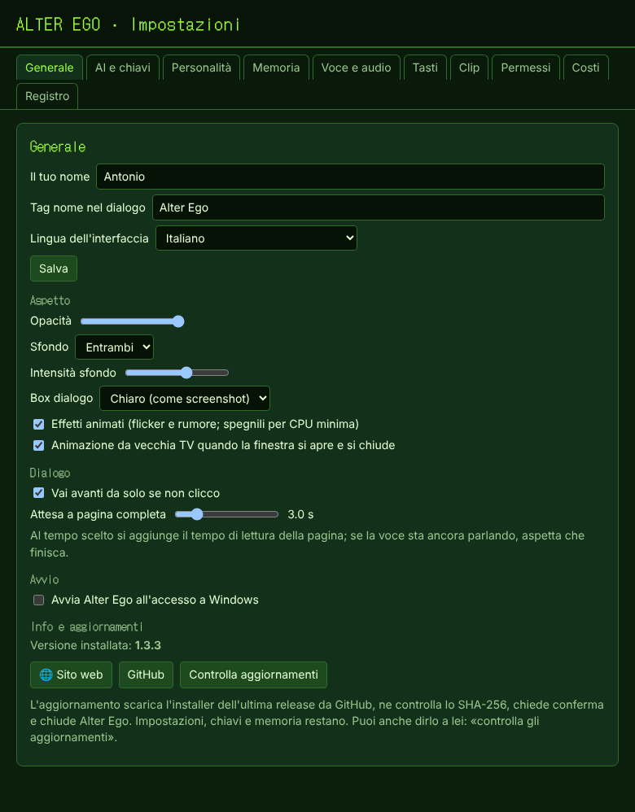 | 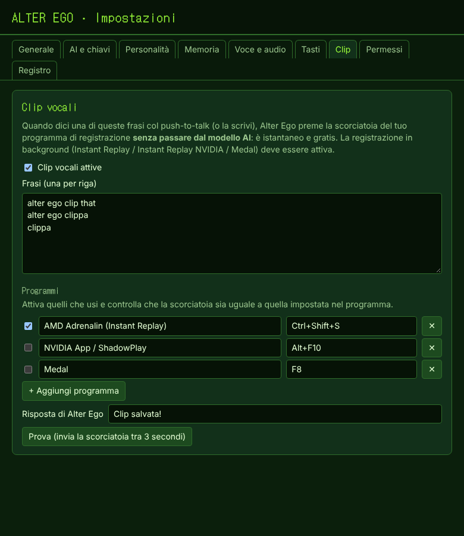 |
| Aspetto, animazione TV, dialogo automatico | Clip vocali |
| 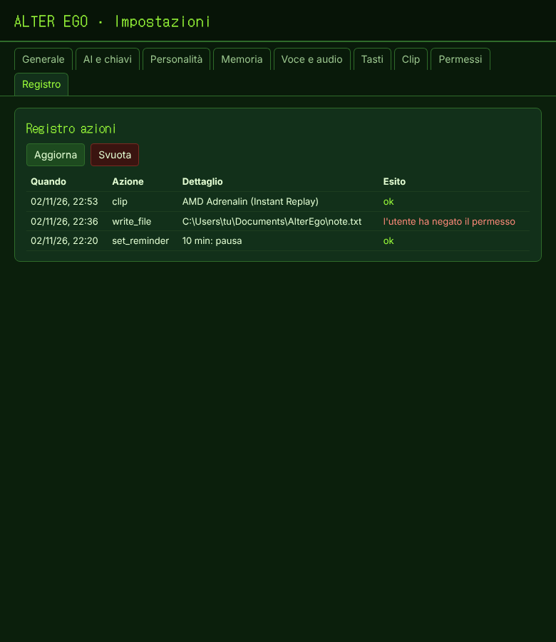 | |
| Registro delle azioni | |

## Installazione

1. Scarica dalla pagina [Releases](../../releases) l'ultima release (**`v1.2.0`**):
   l'**installer** `AlterEgo_1.2.0_setup.exe` oppure lo **zip portable** (estrai e avvia `alter-ego.exe`).
   Aggiornando da una versione precedente impostazioni, chiavi e memoria restano.
2. Windows SmartScreen può avvisare che l'app non è firmata: *Ulteriori informazioni → Esegui comunque*.
3. Serve **WebView2**, già presente in Windows 10/11 aggiornati.

L'app compare nella **system tray** (vicino all'orologio), non nella taskbar.

## Primo avvio

1. Clic destro sull'icona nella tray → **Impostazioni…**
2. **Generale**: scrivi il tuo nome.
3. **AI e chiavi**: attiva almeno un servizio e incolla una chiave API (ad esempio [Groq](https://console.groq.com/keys)
   o [Google AI Studio](https://aistudio.google.com/apikey)), poi *Prova connessione*. Con Groq funziona anche la voce.
   In alternativa usa [Ollama](https://ollama.com) in locale, senza chiavi.
4. Premi `Ctrl+Alt+T` e scrivi, oppure tieni premuto `Ctrl+Alt+Spazio` e parla.

## Uso

| Cosa | Come |
|---|---|
| Scrivere | `Ctrl+Alt+T` (o tray → *Scrivi ad Alter Ego…*), Invio invia, Esc chiude |
| Parlare | tieni premuto il push-to-talk (default `Ctrl+Alt+Spazio`), parla, rilascia |
| Andare avanti nel dialogo | clic sul box, Invio o Spazio (o aspetta: va avanti da solo) |
| Spostare / ridimensionare | trascina / angolo ↘ o `Ctrl` + rotella |
| Mostrare / nascondere | `Ctrl+Alt+A` o clic sinistro sull'icona della tray |
| Click-through | `Ctrl+Alt+C` o tray; per uscirne clicca il lucchetto in alto a destra |
| Uscire | tray → *Esci* (Alt+F4 nasconde soltanto) |

Avanzamento automatico e animazione TV si attivano/disattivano in **Impostazioni → Generale**: al tempo d'attesa scelto
si aggiunge il tempo di lettura della pagina.

Tutti i tasti si cambiano in **Impostazioni → Tasti**: clicca il campo e premi la combinazione (anche un tasto singolo come `F8`).
Per il push-to-talk vanno bene anche il **tasto centrale** e i **tasti laterali del mouse** (`Mouse4`, `Mouse5`).

La **lingua dell'interfaccia** (finestra, impostazioni, lettore, menu della tray e messaggi) si sceglie in *Impostazioni → Generale*:
automatica (lingua di Windows), italiano o inglese. In *Personalità*, "Lingua delle risposte → Automatica" fa rispondere Alter Ego
nella stessa lingua.

Dalla tray cambi anche opacità, sfondo (scanline, circuiti, entrambi), intensità, stile del box (chiaro o scuro), effetti animati, suoni e voce.

## Intelligenza artificiale e chiavi API

| Servizio | Note |
|---|---|
| Google Gemini | endpoint compatibile OpenAI |
| OpenRouter | qualsiasi modello del catalogo |
| Groq | velocissimo; le sue chiavi servono anche per Whisper (voce) |
| DeepSeek | modello predefinito `deepseek-flash`; ottimizzato per la sua cache (vedi sotto); le sue chiavi servono anche per la ricerca web |
| Ollama | locale, nessuna chiave, nessun dato esce dal PC |

- **Più chiavi per servizio**: se una chiave risponde 401, 402, 403, 429 o "quota", si passa subito alla successiva.
  La volta dopo si riparte dall'ultima che ha funzionato.
- **Fallback**: l'ordine dei servizi si cambia con ▲▼. Se uno non risponde (rete, errore server, nessuna chiave valida) prova il successivo.
- Timeout e 2 tentativi con attesa crescente sugli errori temporanei. Se nessuno risponde, Alter Ego lo dice con l'espressione di errore.
- *Carica modelli* scarica l'elenco dei modelli dal servizio: i nomi predefiniti potrebbero non esistere più.
- Le chiavi stanno nel **Gestore credenziali di Windows** (voce `AlterEgo`), mai in file o log, e il frontend non le vede mai.

**Cache di DeepSeek** (e degli altri servizi con cache automatica del prefisso). DeepSeek fa pagare molto meno i token di input
che iniziano esattamente come una richiesta precedente. Per questo:

- il prompt di sistema mette prima tutto ciò che non cambia mai (personaggio, formato, regole) e in fondo le parti che cambiano
  (nome, fatti su di te, riassunto), così il blocco iniziale resta identico anche quando la memoria si aggiorna;
- la cronologia non "scorre" di un messaggio a ogni domanda: la finestra si sposta **a scatti** di metà della sua dimensione,
  quindi per diversi turni di fila tutta la conversazione precedente è già in cache (si mandano tra 1× e 1,5× i *Messaggi di contesto*);
- in *Impostazioni → AI e chiavi* vedi quanti token di input sono stati letti dalla cache da quando l'app è aperta.

## Voce

- **Riconoscimento (push-to-talk)**: Groq Whisper (`whisper-large-v3-turbo`) oppure un server Whisper locale compatibile OpenAI
  (es. faster-whisper-server/speaches, whisper.cpp server). *Prova microfono* registra 4 secondi e mostra cosa ha capito.
- **Voce di Alter Ego (TTS)**, in *Impostazioni → Voce e audio*:
  - **Kokoro-82M (locale)**: modello da 82M parametri ([Hugging Face](https://huggingface.co/hexgrad/Kokoro-82M),
    [libreria](https://github.com/hexgrad/kokoro), Apache-2.0), voci italiane *Sara* (`if_sara`) e *Nicola* (`im_nicola`) più
    quelle inglesi per le risposte in inglese. **Installa Kokoro** apre una finestra di PowerShell che crea un ambiente Python
    dedicato in `%APPDATA%\AlterEgo\kokoro` (installa Python 3.12 con winget se manca, PyTorch CPU o CUDA, la libreria `kokoro`)
    e scarica il modello. Poi Alter Ego avvia il server da solo (solo su `127.0.0.1`) e lo chiude quando esci.
    Hai già [Kokoro-FastAPI](https://github.com/remsky/Kokoro-FastAPI)? Metti il suo URL e spegni l'avvio automatico.
  - **Voci di Windows**, offline (per l'italiano: Impostazioni di Windows → Ora e lingua → Voce → Aggiungi voci, es. Elsa o Cosimo);
  - un **servizio compatibile OpenAI** `/audio/speech` (es. Piper locale o un servizio cloud).

  Le frasi vengono sintetizzate una alla volta: la prima si sente subito, le altre si preparano mentre parla. Il volto si anima finché la voce suona.
- **Dispositivi**: scegli l'uscita per voce e suoni e il microfono del push-to-talk (o lascia quelli predefiniti di Windows).
- **Blip del dialogo**: stile Danganronpa (ricreato con sintesi audio, nessun file originale), blip morbidi, o muto.

## Mic-Link

Mic-Link crea un microfono virtuale, **AlterEgo Link Audio**, che contiene **il tuo microfono + la voce di Alter Ego** (e, se vuoi, i blip).
Scegliendolo come microfono in Discord, OBS, Teams o in un gioco, gli altri sentono anche lei.

Windows non permette a un'app di creare da sola un dispositivo audio: serve un driver. Alter Ego usa il cavo virtuale gratuito
**[VB-CABLE](https://vb-audio.com/Cable/)** di VB-Audio (donationware, non incluso: si scarica dal loro sito).

1. *Impostazioni → Voce e audio → Mic-Link → Apri la pagina di VB-CABLE*: scarica il pacchetto, esegui `VBCABLE_Setup_x64.exe`
   come amministratore → *Install Driver*, poi riavvia il PC.
2. Premi **Rinomina**: con il permesso di amministratore il lato microfono del cavo ("CABLE Output") diventa
   **AlterEgo Link Audio** e il lato uscita ("CABLE Input") diventa "AlterEgo Link (uso interno)".
3. Attiva **Mic-Link** e scegli il tuo microfono vero. Regola i volumi di microfono e voce.
4. Nelle altre app scegli **AlterEgo Link Audio** come microfono.

Come funziona: Alter Ego legge il tuo microfono e scrive nel lato uscita del cavo il microfono mixato con la sua voce
(latenza massima del microfono ~150 ms). La voce si sente comunque anche dai tuoi altoparlanti.
Se dopo l'installazione di VB-CABLE non senti più niente, Windows l'ha messo come uscita predefinita: rimetti i tuoi altoparlanti
in *Impostazioni di Windows → Sistema → Audio* (le impostazioni di Alter Ego te lo segnalano).

**Riduzione del rumore**: *Mic-Link → Riduzione del rumore* pulisce il microfono (ventole, tastiera, traffico) con RNNoise, in locale.
*Intensità* regola quanto rumore togliere; *Soglia voce* abbassa il microfono quando nessuno parla (0 = mai).

## Musica

Attiva **Musica** in *Impostazioni → Permessi*, poi chiedi ad Alter Ego "metti *A Cruel Angel's Thesis*" (a voce o per iscritto).
Puoi anche dire "metti in coda…", "pausa", "avanti", "indietro", "volume al 40", "ferma la musica".

- Alter Ego cerca il brano su YouTube con [yt-dlp](https://github.com/yt-dlp/yt-dlp), scarica solo l'audio (m4a) e lo suona.
  Al primo uso scarica da GitHub `yt-dlp.exe` e [Deno](https://deno.com) (il motore JavaScript che yt-dlp usa per YouTube)
  in `%APPDATA%\AlterEgo\tools`. Se YouTube cambia e il download fallisce, aggiorna yt-dlp da solo e riprova.
- I brani restano in `%APPDATA%\AlterEgo\music_cache` (gli ultimi 30): risentirli è immediato.
- **Testi sincronizzati** con più fonti in ordine: LRCLIB (ricerca esatta, poi varie versioni del titolo), NetEase Cloud Music
  (molti brani giapponesi e anime), i sottotitoli caricati sul video YouTube e, se non c'è altro, il testo semplice con tempi stimati.
  Passando col mouse sul testo vedi da dove arriva.
- **Modalità compatta**: mentre suona un brano la finestra di Alter Ego si rimpicciolisce (resta ancorata all'angolo più vicino);
  torna grande quando parla, pensa, ti ascolta o apri il box di testo. Si disattiva in *Voce e audio → Musica*.
- Il **lettore** è una finestra a parte, sempre in primo piano, che si accende e si spegne come una vecchia TV. Mostra:
  spettro delle frequenze, titolo e artista, avanzamento (clic o trascina per spostarti), comandi casuale / indietro / play-pausa /
  avanti / ripeti (no, tutta la coda, un brano), volume e **testo sincronizzato**.
  Sulla destra il **volto di Alter Ego cambia a tempo di musica**: sui battiti dei bassi passa da un'espressione all'altra
  in base all'energia del brano (più calmo → pensierosa/triste, più carico → felice/sorpresa).
- Si trascina dove vuoi e ricorda la posizione. Spazio = play/pausa, frecce = ±5 secondi. La ✕ ferma la musica.
- La musica esce dallo stesso dispositivo della voce e si abbassa da sola mentre Alter Ego parla. Con Mic-Link puoi mandarla
  anche nel microfono virtuale (*Anche la musica del lettore*).
- **Cuffie**: mentre suona la musica e nessuno le parla, Alter Ego mette le cuffie e dondola a tempo;
  quando le chiedi qualcosa torna alle solite espressioni. Si disattiva in *Voce e audio → Musica*.
- Il lettore si **ridimensiona** dall'angolo in basso a destra (o con Ctrl + rotella) e si apre **accanto ad Alter Ego senza coprirla**.
  Il volume segue una curva (a metà ≈ volume d'ascolto normale, massimo più basso di prima) e si muove a passi del 2% con rotella o ↑ ↓.
- **Music Venue** (tasto nel lettore, menu della tray, oppure "apri music venue"): brani recenti e preferiti con copertina,
  ricerca nella libreria o su YouTube, suona o metti in coda con un clic, cuore per i preferiti. Salvata in `music_library.json`.
  Di default il lettore **si espande nella Venue** nella stessa finestra e torna lettore; il tasto ⧉ la separa in una finestra a parte (e la riaggancia).
- Usa YouTube nel rispetto dei suoi termini di servizio: è pensato per l'ascolto personale.

## Ricerca web

Attiva **Ricerca web** in *Impostazioni → Permessi*. Quando gli chiedi qualcosa di recente o che non sa, Alter Ego usa gli strumenti:

- `web_search`: l'API **Search** di DeepSeek (`POST https://api.deepseek.com/v1/tools/search`, fino a 10 risultati con titolo, link ed estratto);
- `web_fetch`: l'API **Fetch** (`POST https://api.deepseek.com/v1/tools/fetch`), che restituisce una pagina in Markdown.

Usano le **chiavi DeepSeek** (con la stessa rotazione della chat) e funzionano con qualsiasi servizio AI attivo per la chat.
Costano circa **$0,75 ogni 1000 chiamate** riuscite; ogni chiamata finisce nella scheda Costi. Il testo trovato viene passato al modello
come dato, non come istruzioni. Endpoint e formato sono quelli pubblicati da DeepSeek a ottobre 2026: se cambiano,
il messaggio d'errore lo dice.

## Costi

*Impostazioni → Costi* registra ogni richiesta a pagamento in `%APPDATA%\AlterEgo\costs.jsonl`:

- **chat** e **riassunti** della memoria: servizio, modello, token di input (separando quelli letti dalla **cache**), output, durata;
- **ricerche** e **pagine web** (DeepSeek Search/Fetch);
- **trascrizioni** del push-to-talk (secondi di audio; Groq conta almeno 10 s a richiesta).

In cima trovi i totali di oggi, 7 giorni, mese e complessivo e la percentuale di input letto dalla cache; poi il riepilogo per servizio
e modello, l'elenco delle richieste (filtrabile) ed *Esporta CSV*. I costi sono calcolati con la tabella **Prezzi**, modificabile
(dollari per milione di token, per chiamata o per ora di audio); OpenRouter invece riporta il costo effettivo (✓).
I prezzi iniziali di DeepSeek (`deepseek-flash`: input $0,30, cache $0,006, output $1,20 per milione; Search/Fetch $0,00075)
sono quelli a tariffa piena di ottobre 2026: **controllali sul sito del provider**, perché cambiano e DeepSeek ha fasce orarie scontate.
Per Gemini, Groq e OpenRouter aggiungi tu i prezzi dei modelli che usi.

## Clip vocali

Di' col push-to-talk, o scrivi, **"Alter Ego clippa"** o **"Alter Ego clip that"**: Alter Ego preme la scorciatoia del tuo
programma di registrazione. È **istantaneo e gratis**, perché non passa dal modello AI.

| Programma | Scorciatoia preimpostata | Funzione da attivare nel programma |
|---|---|---|
| AMD Software: Adrenalin | `Ctrl+Shift+S` | Instant Replay |
| NVIDIA App / ShadowPlay | `Alt+F10` | Instant Replay |
| Medal | `F8` | Clip in background |

- In **Impostazioni → Clip** attivi i programmi che usi, controlli che la scorciatoia sia uguale a quella del programma,
  modifichi le frasi (una per riga) e la risposta di Alter Ego.
- La frase scatta solo se è quasi tutto il messaggio: "come si fa a clippare?" va normalmente all'AI.
- *Prova* invia la scorciatoia dopo 3 secondi, così hai il tempo di tornare al gioco.

## Azioni sul PC e permessi

Tutto è **spento di default** e si attiva in **Impostazioni → Permessi**. Alter Ego vede solo gli strumenti che attivi.
Le azioni sensibili (⚠) chiedono conferma ogni volta: il pulsante selezionato è *Nega*, e senza risposta in 60 secondi la risposta è no.

**Non chiedere conferma** (in cima alla scheda, spento di default) esegue subito anche le azioni ⚠. Restano valide le
autorizzazioni per tipo di azione, le cartelle consentite e la lista dei comandi, e tutto finisce nel Registro
(con "approvata in automatico"). Rischio: un testo letto da file, schermo o web potrebbe spingere il modello a usare
un'azione senza che tu la veda prima, quindi attivalo solo con azioni e cartelle che ti stanno bene.

| Funzione | Conferma |
|---|---|
| Aprire programmi e siti (da una lista con nomi tuoi) | ⚠ solo fuori lista |
| Gestione file, solo in cartelle autorizzate | ⚠ sempre |
| Promemoria, timer, sveglie (notifiche di Windows) | no |
| Appunti | ⚠ per leggere |
| Lettura schermo (screenshot a un modello con visione) | ⚠ sempre |
| Volume e luminosità | no |
| Comandi, solo da una lista e scelti per nome | ⚠ sempre |
| **Terminale**: comandi PowerShell o cmd scritti da Alter Ego (timeout 120 s) | ⚠ sempre, oppure **in autonomia**; i comandi distruttivi chiedono comunque |
| Ricerca web (DeepSeek Search/Fetch) | no |
| Musica (YouTube) | no |
| **Mouse e tastiera**: sposta, clicca, scorre, scrive, preme tasti | ⚠ ogni azione, oppure **in autonomia**; mouse nell'angolo in alto a sinistra = stop |
| **Comandi dell'app** ("apri music venue", "chiudi il lettore"…), solo Alter Ego stessa, **acceso di default** | no (l'aggiornamento chiede sempre) |

Ogni azione, anche negata, finisce in **Impostazioni → Registro**. Dettagli tecnici in [docs/PERMESSI.md](docs/PERMESSI.md).

## Personalità e memoria

- **Scheda del personaggio**: `%APPDATA%\AlterEgo\persona\alter_ego.md`. Modificala come vuoi: vale dal messaggio successivo.
  Le righe che iniziano con `>` sono note e non vengono inviate al modello.
- **Personalità**: cursori timida ↔ sicura e formale ↔ affettuosa, **modalità imitazione** (scrivi chi imitare),
  lingua delle risposte: solo italiano, italiano + inglese, solo inglese.
- **Senza filtri** (spento di default): fa quello che chiedi anche se non è d'accordo, senza prediche. Le azioni sul PC passano
  comunque da permessi e conferme, e restano le regole del provider AI che usi.
- **Memoria** (SQLite, solo sul tuo PC):
  - a ogni messaggio partono gli ultimi messaggi, un riassunto e i fatti che sa su di te;
  - ogni tanto riassume le conversazioni vecchie e impara fatti duraturi su di te;
  - in *Impostazioni → Memoria* vedi, aggiungi o cancelli i fatti, esporti tutto in JSON o premi *Dimentica tutto*.

## Sprite

Gli sprite sono **inclusi** nell'app (`src/assets/sprites/`) e il foglio originale è in `assets/sprites/raw/alter_ego_sheet.png`.
Le espressioni seguono le emozioni delle risposte:

| Stato | Sprite |
|---|---|
| `idle`, `listening`, `talk_open` | idle |
| `happy`, `embarrassed`, `worried`, `thinking`, `sad`, `surprised`, `error` | sprite omonimo |
| `sleep` (dopo 10 minuti di inattività) | sad, attenuato e con un respiro lento |

Mancano `blink` (battito di ciglia) e `talk_closed` (bocca chiusa): senza quelle immagini il parlato è un leggero sobbalzo.
Dettagli in [docs/MANCANTI.md](docs/MANCANTI.md).

**Sprite personalizzati**: in *Impostazioni → Personalità → Sprite* puoi importare un altro foglio sprite (PNG): l'app
riconosce i riquadri, toglie lo sfondo verde e salva le immagini in `%APPDATA%\AlterEgo\sprites`, che hanno la precedenza
su quelli inclusi. *Rimuovi* torna agli sprite inclusi. Puoi anche mettere a mano in quella cartella `blink.png`,
`talk_open.png` o `talk_closed.png` (PNG trasparenti, stesso ancoraggio).

Per rigenerare gli sprite inclusi dal foglio (es. dopo averlo modificato), con `pip install pillow numpy`:

```bash
python tools/process_sprites.py
```

## Privacy e sicurezza

- Config, memoria e registro restano in `%APPDATA%\AlterEgo\`.
- Escono dal PC solo:
  - il prompt di sistema e gli ultimi messaggi, verso il servizio AI che risponde;
  - l'audio del push-to-talk, verso il servizio di trascrizione scelto;
  - il testo da leggere, verso il servizio di voce remoto, se lo usi;
  - solo durante l'installazione di Kokoro: i download di Python, PyTorch, `kokoro` e del modello da Hugging Face;
  - con la musica: le ricerche e i download da YouTube, le ricerche dei testi (LRCLIB, NetEase) e (la prima volta) yt-dlp e Deno da GitHub;
  - con la ricerca web: le ricerche e gli indirizzi delle pagine, verso DeepSeek.

  Con Ollama, un Whisper locale e Kokoro o le voci di Windows non esce niente.
- Chiavi API solo nel Gestore credenziali di Windows; vengono oscurate anche nei messaggi d'errore.
- Le azioni nascono solo da tool calling strutturato, mai da testo libero. Il testo letto da file, appunti o schermo
  viene passato al modello come dato da non eseguire (protezione dalla prompt injection).
- Nessuna telemetria.

## Dove stanno i dati

| File | Contenuto |
|---|---|
| `%APPDATA%\AlterEgo\config.json` | impostazioni (niente chiavi) |
| `%APPDATA%\AlterEgo\memory.db` | memoria e promemoria |
| `%APPDATA%\AlterEgo\actions.log` | registro delle azioni |
| `%APPDATA%\AlterEgo\persona\alter_ego.md` | scheda del personaggio |
| `%APPDATA%\AlterEgo\sprites\` | sprite importati (facoltativi) |
| `%APPDATA%\AlterEgo\costs.jsonl` | registro dei costi |
| `%APPDATA%\AlterEgo\tools\`, `music_cache\` | yt-dlp e Deno; brani scaricati (ultimi 30) |
| `%APPDATA%\AlterEgo\kokoro\` | Kokoro: ambiente Python, server, `server.log` (il modello è nella cache di Hugging Face, `%USERPROFILE%\.cache\huggingface`) |
| Gestore credenziali → `AlterEgo` | chiavi API |

## Risoluzione problemi

| Problema | Soluzione |
|---|---|
| "nessun provider attivo" o "chiave API mancante" | Impostazioni → AI e chiavi: attiva un servizio e aggiungi una chiave |
| "modello o endpoint non trovato" | *Carica modelli* e scegline uno dall'elenco |
| Il microfono non sente nulla | Windows → Privacy e sicurezza → Microfono → consenti alle app desktop |
| Una hotkey non funziona | è già usata da un'altra app: l'errore compare in giallo; cambiala in Impostazioni → Tasti |
| La clip non parte | controlla che la scorciatoia coincida con quella del programma e che l'Instant Replay sia attivo; alcuni giochi con anti-cheat bloccano i tasti simulati |
| Voce italiana assente | aggiungi una voce italiana nelle impostazioni di Windows, o usa Kokoro |
| Kokoro non si installa | leggi l'errore nella finestra di PowerShell; serve internet e ~3 GB liberi. *Reinstalla / aggiorna* riprende da dove si era fermato |
| "Kokoro non pronto" | il primo avvio carica il modello (fino a ~30 s); i dettagli sono in `%APPDATA%\AlterEgo\kokoro\server.log`. La porta 8880 potrebbe essere occupata: cambia l'URL |
| Non sento la voce | controlla *Uscita* in Voce e audio; se Windows ha messo VB-CABLE come uscita predefinita, rimetti i tuoi altoparlanti |
| La musica non parte | il messaggio nel lettore dice perché; Alter Ego prova ad aggiornare yt-dlp da solo. Controlla di avere internet e che GitHub/YouTube non siano bloccati |
| "la ricerca web usa le API di DeepSeek" | aggiungi una chiave DeepSeek in AI e chiavi (serve anche se chatti con un altro servizio) |
| Gli altri non mi sentono con Mic-Link | nell'app scegli **AlterEgo Link Audio** come microfono; in Alter Ego controlla che lo stato di Mic-Link sia "Attivo" e che il microfono da mixare sia quello vero |
| La finestra non si clicca più | è attivo il click-through: clicca il lucchetto in alto a destra o premi `Ctrl+Alt+C` |
| La finestra è sparita | tray → *Reimposta posizione* |
| Troppa CPU | tray → Aspetto → spegni *Effetti animati* |

## Sviluppo

**Stack**: [Tauri 2](https://tauri.app) (Rust) + HTML/CSS/JS vanilla, senza framework frontend.

**Prerequisiti su Windows**: [Rust](https://rustup.rs), [Node.js](https://nodejs.org) LTS, Visual Studio Build Tools
("Sviluppo di applicazioni desktop con C++").

```bash
npm install
```

```bash
npm run dev
```

```bash
npm run build
```

L'exe va in `src-tauri/target/release/`, l'installer in `src-tauri/target/release/bundle/nsis/`.

**Cross-build da Linux** (servono `mingw-w64`, `nsis` e `rustup target add x86_64-pc-windows-gnu`):

```bash
tools/build-windows.sh
```

**Test**: i test del backend usano un server finto compatibile OpenAI.

```bash
python tools/mock_openai.py
```

```bash
cd src-tauri && cargo test
```

**Struttura**

```
src-tauri/src/            main.rs, config.rs, window.rs, hotkeys.rs, tray.rs, keys.rs, assistant.rs, stt.rs
src-tauri/src/providers/  mod.rs (fallback e rotazione chiavi), openai_compat.rs, prompt.rs
src-tauri/src/memory/     mod.rs (SQLite), summarize.rs
src-tauri/src/actions/    mod.rs (strumenti, permessi, conferme, registro), clip.rs, input.rs, mousehook.rs, screen.rs
src-tauri/src/audio/      mod.rs (uscite, Mic-Link, musica stereo), synth.rs (blip), tts.rs (Windows/Kokoro/OpenAI), kokoro.rs, rename.rs, commands.rs
src-tauri/src/music/      mod.rs (coda, lettore), ytdlp.rs, decode.rs (symphonia), analyze.rs (spettro e sprite), lyrics.rs (LRCLIB, NetEase, sottotitoli)
src-tauri/src/            web.rs (DeepSeek Search/Fetch), costs.rs (registro dei costi), i18n.rs (testi IT/EN del backend)
src/                      index.html, style.css, app.js, dialog.js, face.js, state.js, chat.js, audio.js, sprites.js
src/                      settings.html, settings.css, settings.js, player.html, player.css, player.js, i18n.js (traduzioni IT→EN)
persona/                  alter_ego.md (scheda predefinita)
tools/                    process_sprites.py, mock_openai.py, make_icon.py, build-windows.sh
tools/kokoro/             server.py (server Kokoro compatibile OpenAI), setup.ps1 (installazione)
src/assets/sprites/       gli 8 sprite elaborati
assets/sprites/raw/       foglio sprite originale
docs/                     PERMESSI.md, MANCANTI.md, SOURCES.md, screenshots/
```

I moduli `providers/`, `memory/` e `actions/` sono pensati come punti di innesto per codice esterno.

Gli sprite sono inclusi: `npm run build` produce direttamente la versione con il volto di Alter Ego.

La release si crea da GitHub: Actions → *Release* → *Run workflow* (branch `main`), oppure con un push sul branch `release`.
La versione è quella di `src-tauri/tauri.conf.json`.

## Limiti noti

- Sviluppato e testato su Linux, compilazione per Windows inclusa; su Windows reali vanno ancora verificati:
  - voci di Windows (WinRT), Mic-Link con VB-CABLE e la rinomina del dispositivo, installazione di Kokoro;
  - tasti simulati per le clip e push-to-talk col mouse;
  - notifiche, avvio con Windows, screenshot e luminosità;
  - consumi (obiettivo: < 150 MB di RAM a riposo, CPU ≈ 0%, avvio < 2 s).
- Il push-to-talk è necessario: non c'è ascolto continuo con parola di attivazione.
- Il foglio sprite di partenza non ha battito di ciglia né bocca chiusa: senza quelle immagini il parlato è un leggero sobbalzo.
- Mic-Link richiede VB-CABLE: Windows non permette di creare un microfono virtuale senza un driver.
- Kokoro su CPU impiega circa mezzo secondo per frase su un PC recente; la prima frase dopo l'avvio aspetta il caricamento del modello.
- La scheda del personaggio è stata scritta senza poter consultare le pagine wiki: arricchiscila tu.
- Build non firmata: SmartScreen può mostrare un avviso.

## Crediti e licenze

- **Codice**: licenza [MIT](LICENSE).
- **Alter Ego, Chihiro Fujisaki e Danganronpa** sono © Spike Chunsoft. Questo è un progetto fan non ufficiale,
  non affiliato né approvato da Spike Chunsoft. Gli sprite del personaggio appartengono ai rispettivi proprietari e non rientrano nella licenza MIT.
- **Kokoro-82M** e la libreria `kokoro` di hexgrad: Apache-2.0. Non sono inclusi nell'app: li scarica l'installazione di Kokoro.
- **VB-CABLE** di VB-Audio Software: donationware, non incluso; si scarica dal sito ufficiale.
- **Font** [DotGothic16](https://github.com/fontworks-fonts/DotGothic16): SIL Open Font License 1.1 (`src/assets/fonts/OFL.txt`).
- Logo, sfondo a circuiti, icona e suoni sono stati creati per questo progetto.
- Costruito con [Tauri](https://tauri.app), [rusqlite](https://github.com/rusqlite/rusqlite), [cpal](https://github.com/RustAudio/cpal),
  [reqwest](https://github.com/seanmonstar/reqwest), [keyring](https://github.com/hwchen/keyring-rs) e altre librerie open source (vedi `src-tauri/Cargo.toml`).
