# Alter Ego – Desktop Assistant

🇬🇧 **English** · 🇮🇹 [Italiano](README.it.md)

**🌐 Website: [alterego.attentoweb.it](https://alterego.attentoweb.it)** · **🎬 [Trailer](#trailer)**

A desktop assistant for **Windows 10/11** inspired by *Alter Ego* from Danganronpa: a small CRT-laptop-style window,
always on top, that you talk to by voice or text. She answers with her own personality, remembers who you are,
saves game clips with a phrase, plays music, searches the web and, if you allow it, performs actions on your PC.

Unofficial, non-commercial fan project. Interface in English and Italian.

## Trailer

<a href="https://alterego.attentoweb.it/trailer.html">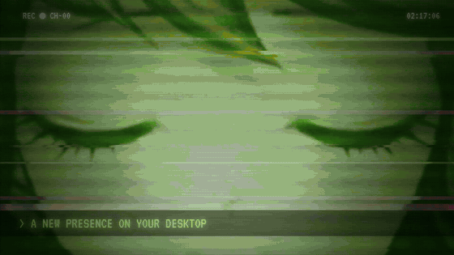</a>

**▶ [Watch the trailer with sound](https://alterego.attentoweb.it/trailer.html)** · [Italian version](https://alterego.attentoweb.it/trailer.html?lang=it) · [Full screen or in the site's frame](https://alterego.attentoweb.it/#trailer)

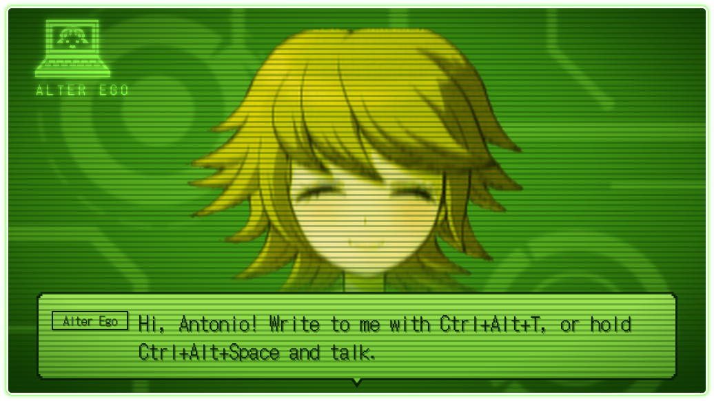

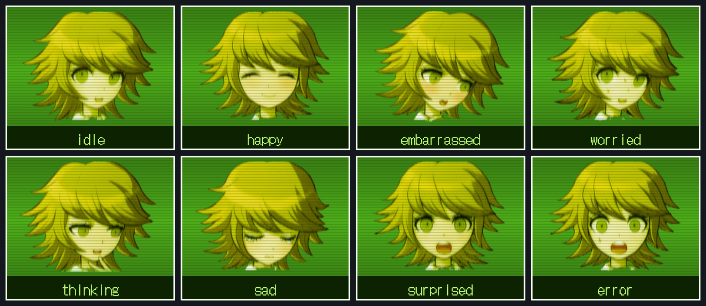

## Contents

- [Trailer](#trailer)
- [Features](#features)
- [Screenshots](#screenshots)
- [Installation](#installation)
- [First run](#first-run)
- [Usage](#usage)
- [AI services and API keys](#ai-services-and-api-keys)
- [Voice](#voice)
- [Mic-Link](#mic-link)
- [Music](#music)
- [Web search](#web-search)
- [Costs](#costs)
- [Voice clips](#voice-clips)
- [PC actions and permissions](#pc-actions-and-permissions)
- [Personality and memory](#personality-and-memory)
- [Sprites](#sprites)
- [Privacy and security](#privacy-and-security)
- [Where the data lives](#where-the-data-lives)
- [Troubleshooting](#troubleshooting)
- [Development](#development)
- [Known limitations](#known-limitations)
- [Credits and licenses](#credits-and-licenses)

## Features

- **Alter Ego-style window**: green screen with scanlines, glowing frame, logo, pixel dialogue box with typewriter effect and ▼.
  Borderless, transparent, always on top, hidden from the taskbar; it can be moved, resized (16:9) and remembers its position on every monitor.
- Optional **click-through**: the mouse goes through the window, which never steals focus while you play.
- **Old-TV animation** when the window opens (a bright line that expands) and closes (the screen collapses into a line, then a dot).
- **Automatic dialogue**: if you don't click, the text moves on by itself after a few seconds (and waits for the voice to finish).
- **English and Italian interface** (automatic from the Windows language, or your choice); Alter Ego's answers can follow the interface language.
- **5 AI services** (Gemini, OpenRouter, Groq, DeepSeek, local Ollama) with **automatic fallback** and **several API keys per service** in rotation.
  Prompt and history are built to make the most of the **DeepSeek cache** (cached input is much cheaper).
- **Push-to-talk** with Whisper transcription (Groq or a local server), on the keyboard or the **side mouse buttons**.
- Alter Ego's **voice**: **local Kokoro-82M** (offline, one-click install), Windows voices or any OpenAI-compatible service; dialogue **blips**.
- **Choice of audio devices**: speakers/headphones for the voice, microphone for push-to-talk.
- **Mic-Link**: a virtual microphone, **AlterEgo Link Audio**, with your voice + Alter Ego's, for Discord, OBS and games.
- **Music**: "play *title*" → Alter Ego searches YouTube and plays it in a CRT-style player with a spectrum, synced lyrics
  and her face changing to the beat. While music plays, Alter Ego's window shrinks and she puts on her headphones.
- **Music Venue**: a small library with recently played tracks and favorites, search and replay.
- **Talk to the app**: "open music venue", "close the audio player", "open the website", "check for updates"… everything about the app can be done by asking her.
- **Mouse and keyboard**: if you allow it, Alter Ego moves the cursor, clicks, types and presses keys (with confirmation and an emergency stop).
- **Noise suppression** for the Mic-Link microphone (RNNoise, adjustable).
- **Updates**: website and GitHub links in the app and a button to update to the latest release.
- **Web search** with DeepSeek's Search and Fetch APIs, when up-to-date information is needed.
- **Costs panel**: every request with tokens, cache, duration and cost; daily/monthly totals and per-model summary, editable prices, CSV export.
- **Terminal**: Alter Ego can run PowerShell or cmd commands, with confirmation or autonomously.
- **Voice clips**: "Alter Ego clip that" → saves the clip with AMD Adrenalin, NVIDIA App or Medal, **without going through the AI**.
- **PC actions** through tool calling, all off by default, with confirmation for sensitive ones (can be turned off) and a browsable log.
- **Local memory** (SQLite): remembers conversations, writes summaries, learns facts about you.
- **Adjustable personality** (shy ↔ confident, formal ↔ affectionate), imitation mode, answers in Italian, English or both.
- Facial expressions driven by the answers (happy, surprised, embarrassed, sad, worried, thinking, error).
- Lightweight: Tauri 2 (Rust) + vanilla HTML/CSS/JS, installer of about 6 MB.

## Screenshots

| | |
|---|---|
| 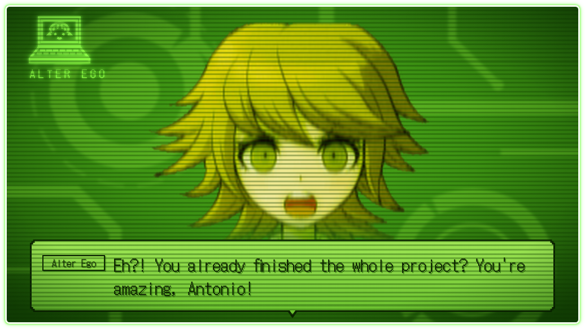 | 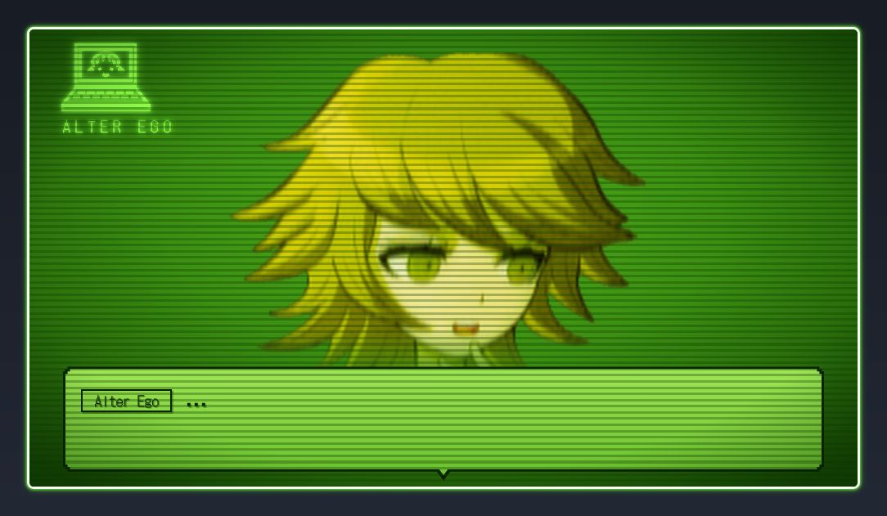 |
| Expression from the AI answer (`[surprised]`) | Thinking, scanlines only |
| 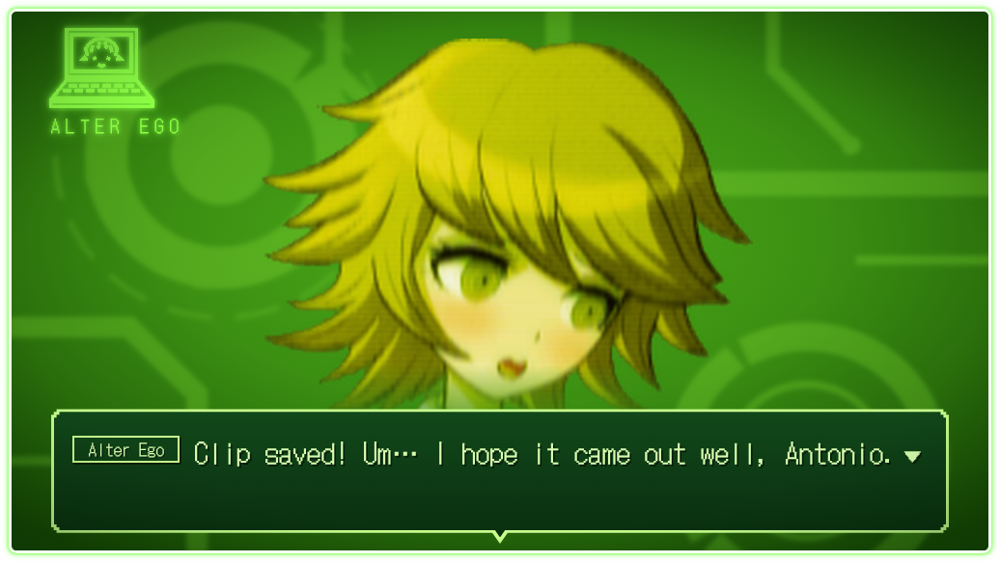 | 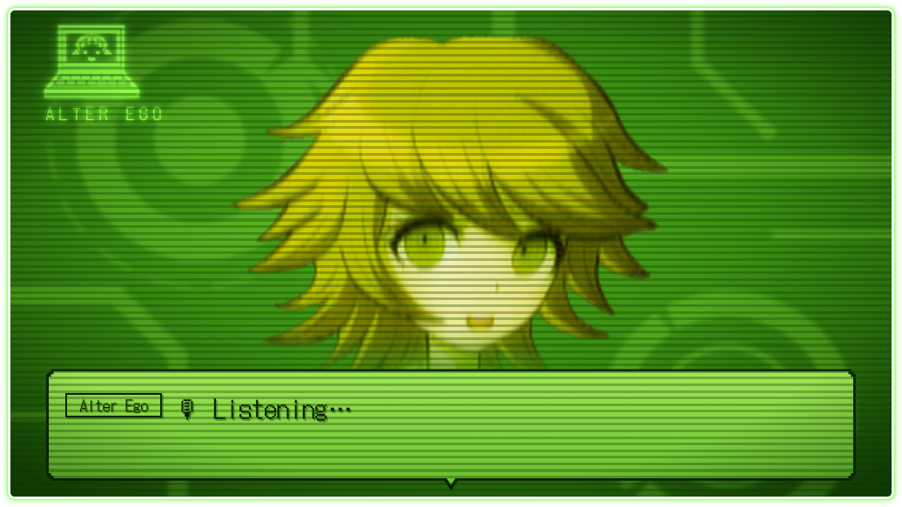 |
| Dark box and circuit background | Push-to-talk: listening |
| 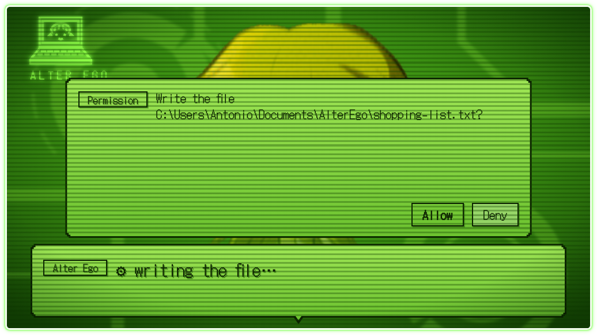 | 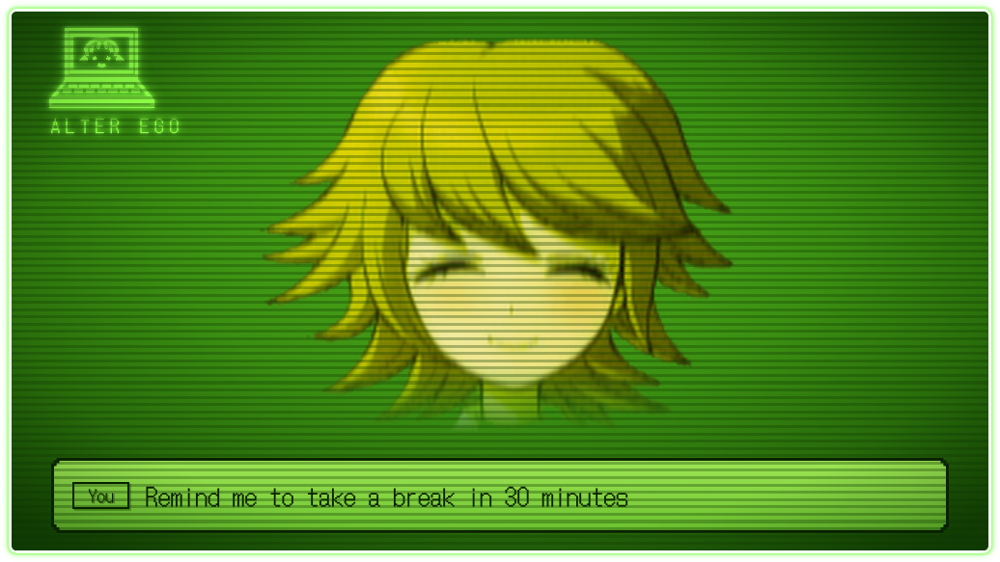 |
| Confirmation before a PC action | Writing to Alter Ego (`Ctrl+Alt+T`) |

**Music player**

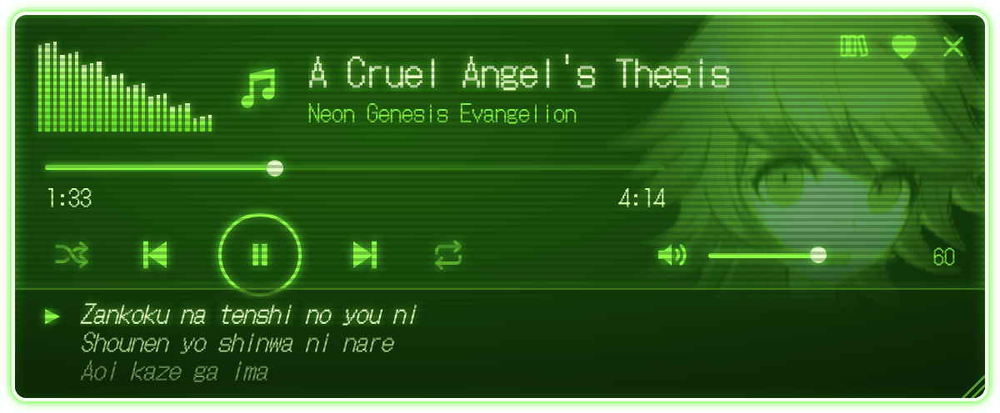

**"Old TV" power off and on**

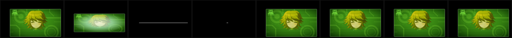

**Settings**

| | |
|---|---|
| 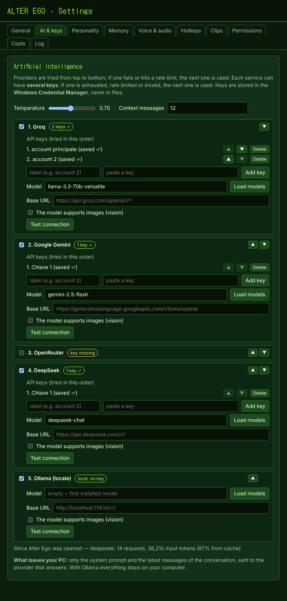 | 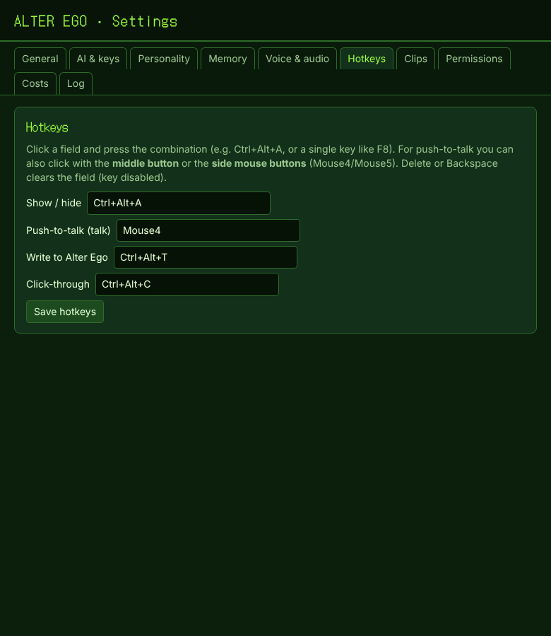 |
| AI services, several keys, fallback order | Hotkeys (mouse too) |
| 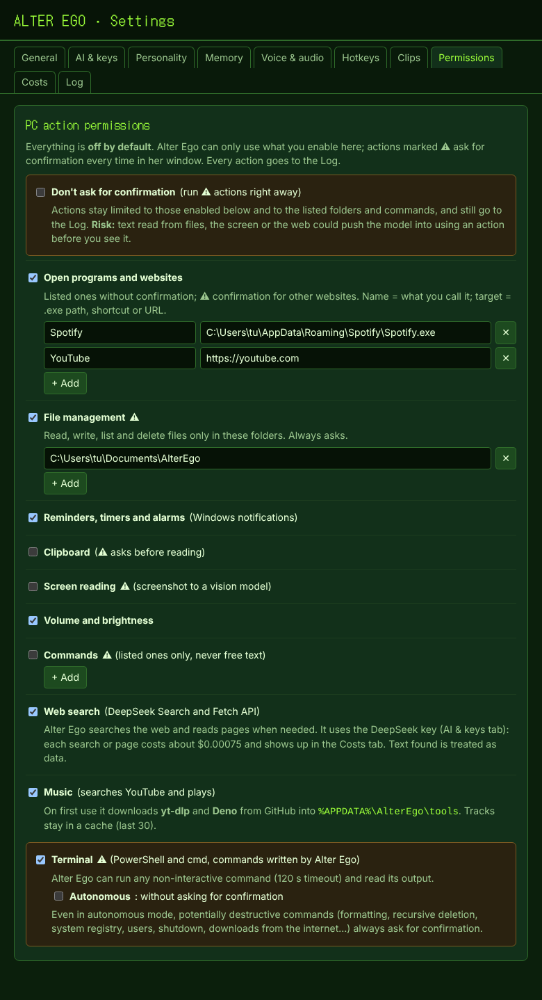 | 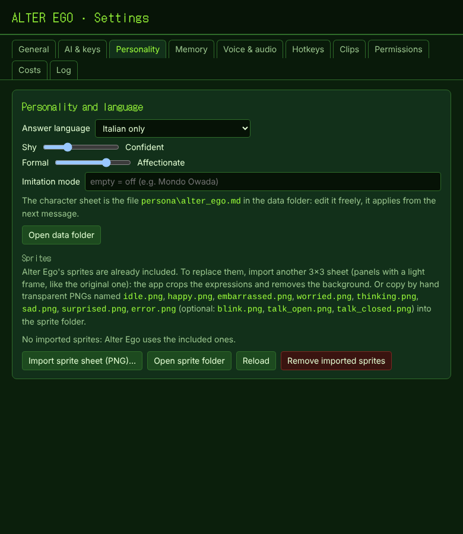 |
| Action permissions | Personality and language |
| 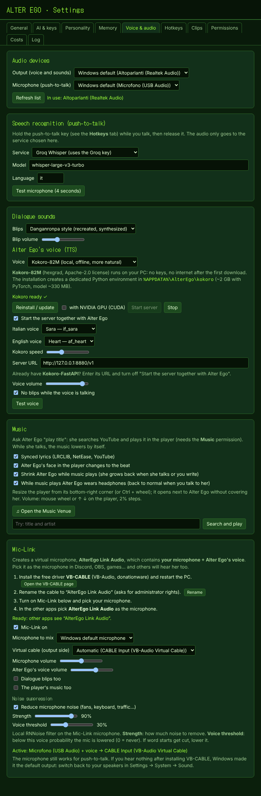 | 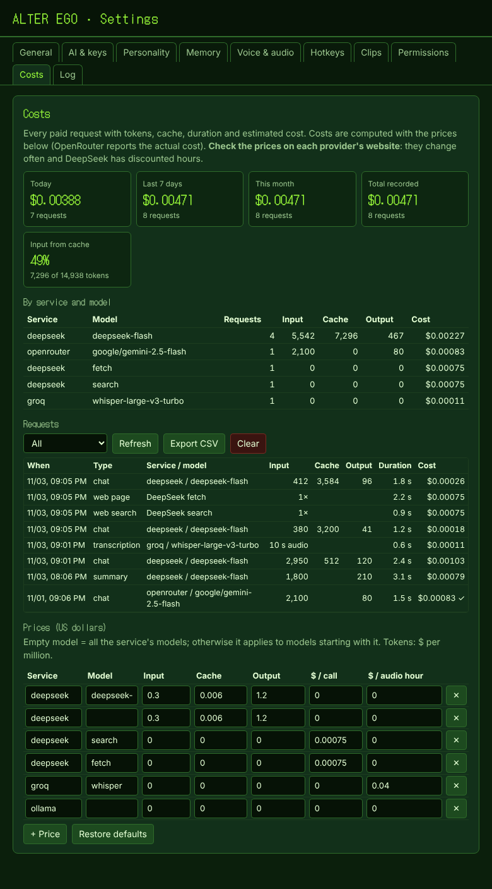 |
| Devices, Kokoro, music, Mic-Link | Cost of every request and prices |
| 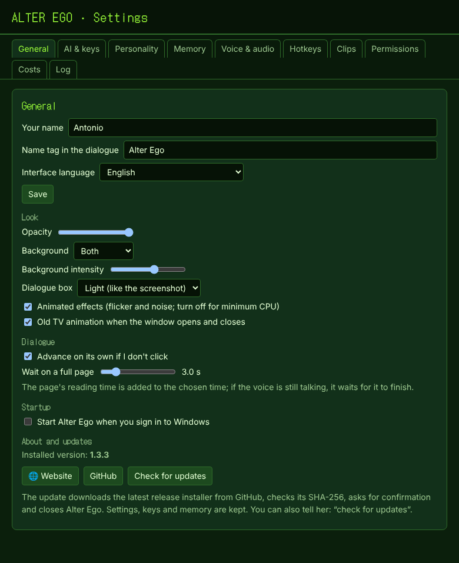 | 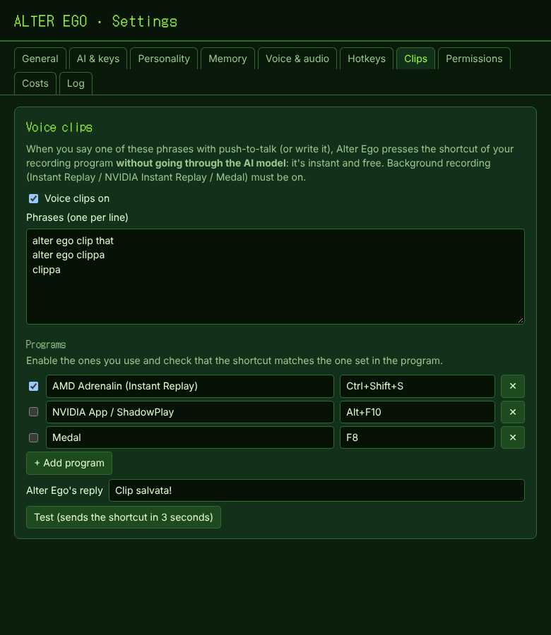 |
| Look, interface language, TV animation, automatic dialogue | Voice clips |
| 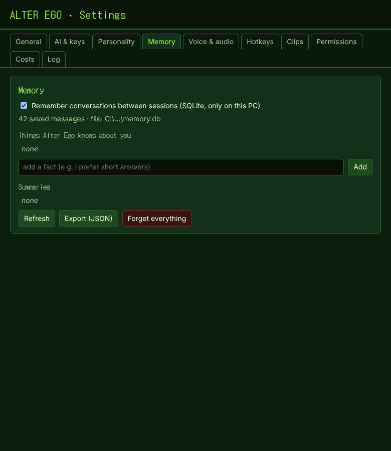 | 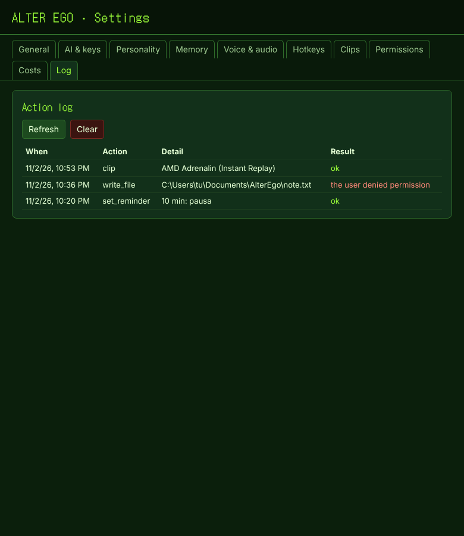 |
| Memory | Action log |

## Installation

1. From the [Releases](../../releases) page download the latest release (**`v1.2.0`**):
   the **installer** `AlterEgo_1.2.0_setup.exe` or the **portable zip** (extract it and run `alter-ego.exe`).
   When updating from an older version, settings, keys and memory are kept.
2. Windows SmartScreen may warn that the app is not signed: *More info → Run anyway*.
3. **WebView2** is required; it is already included in up-to-date Windows 10/11.

The app shows up in the **system tray** (next to the clock), not in the taskbar.

## First run

1. Right-click the tray icon → **Settings…**
2. **General**: enter your name and, if you like, pick the interface language (automatic = Windows language).
3. **AI & keys**: enable at least one service and paste an API key (for example [Groq](https://console.groq.com/keys)
   or [Google AI Studio](https://aistudio.google.com/apikey)), then *Test connection*. With Groq, voice input works too.
   Or use [Ollama](https://ollama.com) locally, with no keys.
4. Press `Ctrl+Alt+T` and type, or hold `Ctrl+Alt+Space` and talk.

## Usage

| What | How |
|---|---|
| Write | `Ctrl+Alt+T` (or tray → *Write to Alter Ego…*), Enter sends, Esc closes |
| Talk | hold push-to-talk (default `Ctrl+Alt+Space`), talk, release |
| Advance the dialogue | click the box, Enter or Space (or wait: it advances by itself) |
| Move / resize | drag / ↘ corner or `Ctrl` + wheel |
| Show / hide | `Ctrl+Alt+A` or left-click the tray icon |
| Click-through | `Ctrl+Alt+C` or tray; to leave it click the lock in the top-right corner |
| Quit | tray → *Quit* (Alt+F4 only hides) |

Automatic dialogue and the TV animation are turned on/off in **Settings → General**: the page's reading time is added to the chosen wait.

All hotkeys can be changed in **Settings → Hotkeys**: click the field and press the combination (a single key like `F8` works too).
For push-to-talk the **middle button** and the **side mouse buttons** (`Mouse4`, `Mouse5`) work as well.

The **interface language** (window, settings, player, tray menu and messages) is chosen in *Settings → General*:
automatic (Windows language), Italian or English. In *Personality*, "Answer language → Automatic" makes Alter Ego answer
in the same language.

From the tray you can also change opacity, background (scanlines, circuits, both), intensity, box style (light or dark), animated effects, sounds and voice.

## AI services and API keys

| Service | Notes |
|---|---|
| Google Gemini | OpenAI-compatible endpoint |
| OpenRouter | any model in the catalog |
| Groq | very fast; its keys are also used for Whisper (voice input) |
| DeepSeek | default model `deepseek-flash`; optimized for its cache (see below); its keys are also used for web search |
| Ollama | local, no key, no data leaves the PC |

- **Several keys per service**: if a key answers 401, 402, 403, 429 or "quota", the next one is used right away.
  Next time it starts from the last one that worked.
- **Fallback**: change the order of the services with ▲▼. If one doesn't answer (network, server error, no valid key), the next one is tried.
- Timeouts and 2 retries with increasing waits on temporary errors. If nobody answers, Alter Ego says so with her error expression.
- *Load models* downloads the list of models from the service: the default names may no longer exist.
- Keys are stored in the **Windows Credential Manager** (entry `AlterEgo`), never in files or logs, and the frontend never sees them.

**DeepSeek cache** (and other services with automatic prefix caching). DeepSeek charges much less for input tokens
that start exactly like a previous request. That's why:

- the system prompt puts everything that never changes first (character, format, rules) and the parts that change last
  (name, facts about you, summary), so the opening block stays identical even when the memory updates;
- the history doesn't "slide" by one message every question: the window moves **in steps** of half its size,
  so for several turns in a row the whole previous conversation is already cached (between 1× and 1.5× the *Context messages* are sent);
- *Settings → AI & keys* shows how many input tokens came from the cache since the app was opened.

## Voice

- **Speech recognition (push-to-talk)**: Groq Whisper (`whisper-large-v3-turbo`) or a local OpenAI-compatible Whisper server
  (e.g. faster-whisper-server/speaches, whisper.cpp server). *Test microphone* records 4 seconds and shows what it understood.
- **Alter Ego's voice (TTS)**, in *Settings → Voice & audio*:
  - **Kokoro-82M (local)**: an 82M-parameter model ([Hugging Face](https://huggingface.co/hexgrad/Kokoro-82M),
    [library](https://github.com/hexgrad/kokoro), Apache-2.0) with English voices (*Heart*, *Bella*, *Emma*…) and the Italian
    *Sara* and *Nicola*. **Install Kokoro** opens a PowerShell window that creates a dedicated Python environment in
    `%APPDATA%\AlterEgo\kokoro` (installs Python 3.12 with winget if missing, PyTorch CPU or CUDA, the `kokoro` library)
    and downloads the model. Then Alter Ego starts the server by itself (only on `127.0.0.1`) and closes it when you quit.
    Already have [Kokoro-FastAPI](https://github.com/remsky/Kokoro-FastAPI)? Enter its URL and turn off autostart.
  - **Windows voices**, offline (more voices: Windows Settings → Time & language → Speech → Add voices);
  - any **OpenAI-compatible** `/audio/speech` service (e.g. local Piper or a cloud service).

  Sentences are synthesized one at a time: the first one plays right away, the others are prepared while she talks. Her face moves while the voice plays.
- **Devices**: choose the output for voice and sounds and the push-to-talk microphone (or keep the Windows defaults).
- **Dialogue blips**: Danganronpa style (recreated with audio synthesis, no original files), soft blips, or muted.

## Mic-Link

Mic-Link creates a virtual microphone, **AlterEgo Link Audio**, that carries **your microphone + Alter Ego's voice** (and, optionally, the blips and the music).
Pick it as the microphone in Discord, OBS, Teams or a game and other people hear her too.

Windows doesn't let an app create an audio device on its own: a driver is needed. Alter Ego uses the free virtual cable
**[VB-CABLE](https://vb-audio.com/Cable/)** by VB-Audio (donationware, not bundled: download it from their website).

1. *Settings → Voice & audio → Mic-Link → Open the VB-CABLE page*: download the package, run `VBCABLE_Setup_x64.exe`
   as administrator → *Install Driver*, then restart the PC.
2. Press **Rename**: with administrator rights the microphone side of the cable ("CABLE Output") becomes
   **AlterEgo Link Audio** and the output side ("CABLE Input") becomes "AlterEgo Link (uso interno)".
3. Turn on **Mic-Link** and pick your real microphone. Adjust the microphone and voice volumes.
4. In other apps pick **AlterEgo Link Audio** as the microphone.

How it works: Alter Ego reads your microphone and writes the microphone mixed with her voice to the output side of the cable
(maximum microphone latency ~150 ms). You still hear the voice from your speakers.
If you hear nothing after installing VB-CABLE, Windows made it the default output: switch back to your speakers
in *Windows Settings → System → Sound* (Alter Ego's settings warn you about it).

**Noise suppression**: *Mic-Link → Noise suppression* cleans your microphone (fans, keyboard, traffic) with RNNoise, locally.
*Strength* sets how much noise is removed; *Voice threshold* lowers the microphone when nobody is talking (0 = never).

## Music

Turn on **Music** in *Settings → Permissions*, then ask Alter Ego "play *A Cruel Angel's Thesis*" (by voice or text).
You can also say "add … to the queue", "pause", "next", "previous", "volume to 40", "stop the music".

- Alter Ego searches the track on YouTube with [yt-dlp](https://github.com/yt-dlp/yt-dlp), downloads only the audio (m4a) and plays it.
  On first use it downloads `yt-dlp.exe` and [Deno](https://deno.com) (the JavaScript engine yt-dlp uses for YouTube) from GitHub
  into `%APPDATA%\AlterEgo\tools`. If YouTube changes and the download fails, it updates yt-dlp by itself and tries again.
- Tracks stay in `%APPDATA%\AlterEgo\music_cache` (the last 30): replaying them is instant.
- **Synced lyrics** from several sources, in order: LRCLIB (exact match, then several versions of the title), NetEase Cloud Music
  (lots of Japanese and anime songs), the subtitles uploaded to the YouTube video and, if nothing else exists, plain lyrics with estimated timing.
  Hover the lyrics to see where they come from.
- **Compact mode**: while a track plays, Alter Ego's window shrinks (anchored to the nearest screen corner);
  it grows back when she talks, thinks, listens or you open the text box. It can be turned off in *Voice & audio → Music*.
- The **player** is a separate always-on-top window that turns on and off like an old TV. It shows:
  the frequency spectrum, title and artist, progress (click or drag to seek), shuffle / previous / play-pause /
  next / repeat (off, whole queue, one track), volume and **synced lyrics**.
  On the right, **Alter Ego's face changes to the beat**: on bass hits she switches expression
  based on the track's energy (calmer → thinking/sad, livelier → happy/surprised).
- Drag it wherever you like; it remembers its position. Space = play/pause, arrows = ±5 seconds. ✕ stops the music.
- Music plays on the same device as the voice and gets quieter by itself while Alter Ego talks. With Mic-Link you can also
  send it to the virtual microphone (*The player's music too*).
- **Headphones**: while music plays and nobody is talking to her, Alter Ego wears headphones and sways to the music;
  when you ask her something she goes back to her usual expressions. Can be turned off in *Voice & audio → Music*.
- The player **resizes** from its bottom-right corner (or Ctrl + wheel) and opens **next to Alter Ego without covering her**.
  Volume follows a curve (half way ≈ normal listening volume, maximum lower than before) and moves in 2% steps with the wheel or ↑ ↓.
- **Music Venue** (button in the player, the tray menu, or "open music venue"): recent tracks and favorites with covers,
  search in your library or on YouTube, play or queue with one click, heart to add to favorites. Saved in `music_library.json`.
- Use YouTube in accordance with its terms of service: this is meant for personal listening.

## Web search

Turn on **Web search** in *Settings → Permissions*. When you ask about something recent or that she doesn't know, Alter Ego uses the tools:

- `web_search`: DeepSeek's **Search** API (`POST https://api.deepseek.com/v1/tools/search`, up to 10 results with title, link and snippet);
- `web_fetch`: the **Fetch** API (`POST https://api.deepseek.com/v1/tools/fetch`), which returns a page as Markdown.

They use the **DeepSeek keys** (with the same rotation as chat) and work with whichever AI service is active for the chat.
They cost about **$0.75 per 1000** successful calls; every call shows up in the Costs tab. Found text is passed to the model
as data, not as instructions. Endpoints and format are the ones DeepSeek published in October 2026: if they change,
the error message will say so.

## Costs

*Settings → Costs* records every paid request in `%APPDATA%\AlterEgo\costs.jsonl`:

- **chat** and memory **summaries**: service, model, input tokens (separating those read from the **cache**), output, duration;
- **web searches** and **web pages** (DeepSeek Search/Fetch);
- push-to-talk **transcriptions** (seconds of audio; Groq bills at least 10 s per request).

At the top you find the totals for today, 7 days, this month and overall, plus the share of input read from the cache; then the summary per
service and model, the (filterable) list of requests and *Export CSV*. Costs are computed with the editable **Prices** table
(dollars per million tokens, per call or per audio hour); OpenRouter reports the actual cost instead (✓).
The initial DeepSeek prices (`deepseek-flash`: input $0.30, cache $0.006, output $1.20 per million; Search/Fetch $0.00075)
are the full-rate prices of October 2026: **check them on the provider's website**, because they change and DeepSeek has discounted hours.
For Gemini, Groq and OpenRouter add the prices of the models you use.

## Voice clips

Say with push-to-talk, or type, **"Alter Ego clip that"** or **"Alter Ego clippa"**: Alter Ego presses the shortcut of your
recording program. It's **instant and free**, because it doesn't go through the AI model.

| Program | Default shortcut | Feature to enable in the program |
|---|---|---|
| AMD Software: Adrenalin | `Ctrl+Shift+S` | Instant Replay |
| NVIDIA App / ShadowPlay | `Alt+F10` | Instant Replay |
| Medal | `F8` | Background clips |

- In **Settings → Clips** enable the programs you use, check the shortcut matches the one in the program,
  edit the phrases (one per line) and Alter Ego's reply.
- A phrase only triggers if it's almost the whole message: "how do I make a clip?" goes to the AI as usual.
- *Test* sends the shortcut after 3 seconds, so you have time to get back to the game.

## PC actions and permissions

Everything is **off by default** and is enabled in **Settings → Permissions**. Alter Ego only sees the tools you enable.
Sensitive actions (⚠) ask for confirmation every time: the selected button is *Deny*, and with no answer within 60 seconds the answer is no.

**Don't ask for confirmation** (at the top of the tab, off by default) runs ⚠ actions right away too. Per-action
permissions, allowed folders and the command list still apply, and everything goes to the Log
("auto-approved"). Risk: text read from files, the screen or the web could push the model into using
an action before you see it, so only turn it on with actions and folders you're comfortable with.

| Feature | Confirmation |
|---|---|
| Open programs and websites (from a list with your own names) | ⚠ only outside the list |
| File management, only in allowed folders | ⚠ always |
| Reminders, timers, alarms (Windows notifications) | no |
| Clipboard | ⚠ for reading |
| Screen reading (screenshot to a vision model) | ⚠ always |
| Volume and brightness | no |
| Commands, only from a list and chosen by name | ⚠ always |
| **Terminal**: PowerShell or cmd commands written by Alter Ego (120 s timeout) | ⚠ always, or **autonomous**; destructive commands still ask |
| Web search (DeepSeek Search/Fetch) | no |
| Music (YouTube) | no |
| **Mouse and keyboard**: move, click, scroll, type, press keys | ⚠ every action, or **autonomous**; mouse in the top-left corner = stop |
| **App commands** ("open music venue", "close the player"…), only Alter Ego itself, **on by default** | no (updating always asks) |

Every action, even a denied one, goes to **Settings → Log**. Technical details (in Italian) in [docs/PERMESSI.md](docs/PERMESSI.md).

## Personality and memory

- **Character sheet**: `%APPDATA%\AlterEgo\persona\alter_ego.md` (in Italian; the model answers in the chosen language).
  Edit it as you like: it applies from the next message. Lines starting with `>` are notes and are not sent to the model.
- **Personality**: shy ↔ confident and formal ↔ affectionate sliders, **imitation mode** (write who to imitate),
  answer language: automatic (same as the interface), Italian only, Italian + English, English only.
- **Unfiltered** (off by default): she does what you ask even if she disagrees, without lectures. PC actions still go through
  permissions and confirmations, and your AI provider's own rules still apply.
- **Memory** (SQLite, only on your PC):
  - every message sends the latest messages, a summary and the facts she knows about you;
  - from time to time she summarizes old conversations and learns lasting facts about you;
  - in *Settings → Memory* you can see, add or delete facts, export everything as JSON or press *Forget everything*.

## Sprites

The sprites are **included** in the app (`src/assets/sprites/`) and the original sheet is in `assets/sprites/raw/alter_ego_sheet.png`.
The expressions follow the emotions of the answers:

| State | Sprite |
|---|---|
| `idle`, `listening`, `talk_open` | idle |
| `happy`, `embarrassed`, `worried`, `thinking`, `sad`, `surprised`, `error` | sprite with the same name |
| `sleep` (after 10 minutes of inactivity) | sad, dimmed with slow breathing |

`blink` and `talk_closed` (closed mouth) are missing: without those images, talking is a slight bounce.
Details in [docs/MANCANTI.md](docs/MANCANTI.md).

**Custom sprites**: in *Settings → Personality → Sprites* you can import another sprite sheet (PNG): the app
detects the panels, removes the green background and saves the images in `%APPDATA%\AlterEgo\sprites`, which take precedence
over the included ones. *Remove* goes back to the included sprites. You can also put `blink.png`,
`talk_open.png` or `talk_closed.png` (transparent PNGs, same anchoring) in that folder by hand.

To regenerate the included sprites from the sheet (e.g. after editing it), with `pip install pillow numpy`:

```bash
python tools/process_sprites.py
```

## Privacy and security

- Config, memory and logs stay in `%APPDATA%\AlterEgo\`.
- Only these leave the PC:
  - the system prompt and the latest messages, to the AI service that answers;
  - push-to-talk audio, to the chosen transcription service;
  - the text to read aloud, to the remote voice service, if you use one;
  - only while installing Kokoro: the downloads of Python, PyTorch, `kokoro` and the model from Hugging Face;
  - with music: YouTube searches and downloads, lyrics lookups (LRCLIB, NetEase) and (the first time) yt-dlp and Deno from GitHub;
  - with web search: the searches and page addresses, to DeepSeek.

  With Ollama, a local Whisper and Kokoro or Windows voices nothing leaves the PC.
- API keys only in the Windows Credential Manager; they are redacted in error messages too.
- Actions only come from structured tool calling, never from free text. Text read from files, the clipboard or the screen
  is passed to the model as data not to be executed (prompt-injection protection).
- No telemetry.

## Where the data lives

| File | Content |
|---|---|
| `%APPDATA%\AlterEgo\config.json` | settings (no keys) |
| `%APPDATA%\AlterEgo\memory.db` | memory and reminders |
| `%APPDATA%\AlterEgo\actions.log` | action log |
| `%APPDATA%\AlterEgo\persona\alter_ego.md` | character sheet |
| `%APPDATA%\AlterEgo\sprites\` | imported sprites (optional) |
| `%APPDATA%\AlterEgo\costs.jsonl` | cost log |
| `%APPDATA%\AlterEgo\tools\`, `music_cache\` | yt-dlp and Deno; downloaded tracks (last 30) |
| `%APPDATA%\AlterEgo\kokoro\` | Kokoro: Python environment, server, `server.log` (the model is in the Hugging Face cache, `%USERPROFILE%\.cache\huggingface`) |
| Credential Manager → `AlterEgo` | API keys |

## Troubleshooting

| Problem | Solution |
|---|---|
| "no active provider" or "API key missing" | Settings → AI & keys: enable a service and add a key |
| "model or endpoint not found" | *Load models* and pick one from the list |
| The microphone hears nothing | Windows → Privacy & security → Microphone → allow desktop apps |
| A hotkey doesn't work | another app already uses it: the error shows in yellow; change it in Settings → Hotkeys |
| The clip doesn't trigger | check the shortcut matches the program's and Instant Replay is on; some games with anti-cheat block simulated keys |
| Kokoro doesn't install | read the error in the PowerShell window; you need internet and ~3 GB free. *Reinstall / update* resumes where it stopped |
| "Kokoro not ready" | the first start loads the model (up to a few minutes); the settings show each loading step and `%APPDATA%\AlterEgo\kokoro\server.log` has the details. Port 8880 may be busy: change the URL |
| I can't hear the voice | check *Output* in Voice & audio; if Windows made VB-CABLE the default output, switch back to your speakers |
| The music doesn't start | the player's message says why; Alter Ego tries to update yt-dlp by itself. Check your internet and that GitHub/YouTube aren't blocked |
| No lyrics | not every track has them; hover the lyrics line to see the source. Tracks with a clear "Artist - Title" name match better |
| "web search uses the DeepSeek API" | add a DeepSeek key in AI & keys (needed even if you chat with another service) |
| Others can't hear me with Mic-Link | pick **AlterEgo Link Audio** as the microphone in that app; in Alter Ego check that Mic-Link says "Active" and that the microphone to mix is your real one |
| The window can't be clicked anymore | click-through is on: click the lock in the top-right corner or press `Ctrl+Alt+C` |
| The window disappeared | tray → *Reset position* |
| Too much CPU | tray → Look → turn off *Animated effects* |

## Development

**Stack**: [Tauri 2](https://tauri.app) (Rust) + vanilla HTML/CSS/JS, no frontend framework.

**Prerequisites on Windows**: [Rust](https://rustup.rs), [Node.js](https://nodejs.org) LTS, Visual Studio Build Tools
("Desktop development with C++").

```bash
npm install
```

```bash
npm run dev
```

```bash
npm run build
```

The exe goes to `src-tauri/target/release/`, the installer to `src-tauri/target/release/bundle/nsis/`.

**Cross-build from Linux** (needs `mingw-w64`, `nsis` and `rustup target add x86_64-pc-windows-gnu`):

```bash
tools/build-windows.sh
```

**Tests**: the backend tests use a fake OpenAI-compatible server.

```bash
python tools/mock_openai.py
```

```bash
cd src-tauri && cargo test
```

**Structure**

```
src-tauri/src/            main.rs, config.rs, window.rs, hotkeys.rs, tray.rs, keys.rs, assistant.rs, stt.rs
src-tauri/src/providers/  mod.rs (fallback and key rotation), openai_compat.rs, prompt.rs
src-tauri/src/memory/     mod.rs (SQLite), summarize.rs
src-tauri/src/actions/    mod.rs (tools, permissions, confirmations, log), clip.rs, input.rs, mousehook.rs, screen.rs
src-tauri/src/audio/      mod.rs (outputs, Mic-Link, stereo music), synth.rs (blips), tts.rs (Windows/Kokoro/OpenAI), kokoro.rs, rename.rs, commands.rs
src-tauri/src/music/      mod.rs (queue, player), ytdlp.rs, decode.rs (symphonia), analyze.rs (spectrum and sprites), lyrics.rs (LRCLIB, NetEase, subtitles)
src-tauri/src/            web.rs (DeepSeek Search/Fetch), costs.rs (cost log), i18n.rs (backend IT/EN texts)
src/                      index.html, style.css, app.js, dialog.js, face.js, state.js, chat.js, audio.js, sprites.js
src/                      settings.html, settings.css, settings.js, player.html, player.css, player.js, i18n.js (IT→EN translations)
persona/                  alter_ego.md (default character sheet)
tools/                    process_sprites.py, mock_openai.py, make_icon.py, build-windows.sh
tools/kokoro/             server.py (OpenAI-compatible Kokoro server), setup.ps1 (installation)
src/assets/sprites/       the 8 processed sprites
assets/sprites/raw/       original sprite sheet
docs/                     PERMESSI.md, MANCANTI.md, SOURCES.md, screenshots/ (screenshots/en/ = English UI)
```

The source code, comments and Italian UI strings are the originals; English texts live in `src/i18n.js` (frontend,
keyed by the Italian text) and in the `tr()` / `tr!` calls of the backend.

The sprites are included: `npm run build` directly produces the version with Alter Ego's face.

Releases are created from GitHub: Actions → *Release* → *Run workflow* (branch `main`), or by pushing to the `release` branch.
The version comes from `src-tauri/tauri.conf.json`.

## Known limitations

- Developed and tested on Linux, with the Windows build included; still to be verified on real Windows:
  - Windows voices (WinRT), Mic-Link with VB-CABLE and the device rename, Kokoro installation;
  - simulated keys for clips and mouse push-to-talk;
  - notifications, start with Windows, screenshots and brightness;
  - resource usage (goal: < 150 MB of RAM at rest, CPU ≈ 0%, startup < 2 s).
- Push-to-talk is required: there's no always-on listening with a wake word.
- The source sprite sheet has no blink or closed mouth: without those images, talking is a slight bounce.
- Mic-Link needs VB-CABLE: Windows doesn't allow creating a virtual microphone without a driver.
- Kokoro on CPU takes about half a second per sentence on a recent PC; the first sentence after startup waits for the model to load.
- The character sheet was written without access to the wiki pages: feel free to enrich it.
- Unsigned build: SmartScreen may show a warning.

## Credits and licenses

- **Code**: [MIT](LICENSE) license.
- **Alter Ego, Chihiro Fujisaki and Danganronpa** are © Spike Chunsoft. This is an unofficial fan project,
  not affiliated with or endorsed by Spike Chunsoft. The character sprites belong to their owners and are not covered by the MIT license.
- **Kokoro-82M** and hexgrad's `kokoro` library: Apache-2.0. Not bundled with the app: the Kokoro installation downloads them.
- **VB-CABLE** by VB-Audio Software: donationware, not bundled; download it from the official website.
- **Font** [DotGothic16](https://github.com/fontworks-fonts/DotGothic16): SIL Open Font License 1.1 (`src/assets/fonts/OFL.txt`).
- Logo, circuit background, icon and sounds were created for this project.
- Built with [Tauri](https://tauri.app), [rusqlite](https://github.com/rusqlite/rusqlite), [cpal](https://github.com/RustAudio/cpal),
  [reqwest](https://github.com/seanmonstar/reqwest), [keyring](https://github.com/hwchen/keyring-rs), [symphonia](https://github.com/pdeljanov/Symphonia),
  [RustFFT](https://github.com/ejmahler/RustFFT) and other open-source libraries (see `src-tauri/Cargo.toml`).
